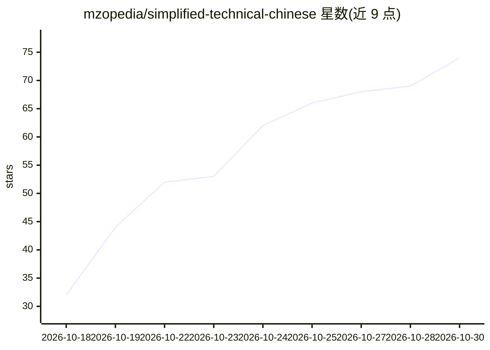

# mzopedia/simplified-technical-chinese

⭐ 74 · Python · MIT · 推送 2026-10-05 · [GitHub](https://github.com/mzopedia/simplified-technical-chinese) · 个人维护 · 中文 README

**中文技术写作受控语言规范：40条规则+词表+零依赖检查脚本**

借鉴 ASD-STE100 方法为中文设计的受控写作规范：40 条编号规则（分【必须】/【建议】两级）、约 170 条受控词表（一词一义、禁用词替换）、零依赖 Python 检查脚本（输出行号/规则号/级别，支持 --strict 用于 CI）。规则针对中文歧义来源（名词化、长定语、以上/以下端点歧义等），在 350 万字真实中文技术文档上校准过。提供 SKILL.md 供 Claude Code、Codex、Cursor 等 agent 作为技能使用，也可直接写入系统提示词。

## 筛选速览

| 维度 | 判定 | 备注 |
|---|---|---|
| AI 角色 | `ai-knowledge` | 知识聚合/清单类 |
| 许可风险 | `permissive` | MIT |
| 部署形态 | `library` | 以包/库形式分发 |
| 模型依赖 | — | README 未给出锁定关系 |
| 硬件要求 | — | 无带数字的原话,不猜 |
| 安装摩擦 | `low` | 无编译、无系统依赖或容器化 |
| 成熟度 | — | 结构信号不足 |

## 能力要点

- 40 条编号写作规则 + 约 170 条受控词表（一词一义）
- 零依赖 Python 3.9+ 检查脚本，支持 --strict 与 --json 输出，可接入 CI
- 提供 SKILL.md 技能文件，兼容 Claude Code、Codex、Cursor 等 agent
- 规则在 350 万字、2856 个文件的真实中文技术文档上校准

## 适用场景

- 让 AI agent 按受控规范写中文技术说明并自动检查
- 团队统一技术文档用词与句式，在 CI 中拦截违规
- 为中文技术写作建立可自动检查的规则与词表

## 场景标签

`提示工程` `AI 写作` · 领域:Agent 开发

## 证据(README 行号)

> L5: Simplified Technical Chinese（STC）。一套受控的中文写法，用于技术说明、操作步骤、接口文档和 AI 的解释性回答。目标是读者读一遍就不会读错。
> L44: |规范.md|写作规则。6 节，40 条，每条带「不批准 / 批准」例句。规则分【必须】和【建议】两级|
> L47: |SKILL.md|给 Claude Code、Codex、Cursor 这类 agent 用的技能文件|

## 星数曲线

2026-10-18 32 → 2026-10-30 74（+42）

---
*卡片 v1 · prompt 1.4 · 生成 2026-10-24 · 置信度 high · 依据 README sha `06d700e11e00` · [字段定义](../../DATASET.md)*
