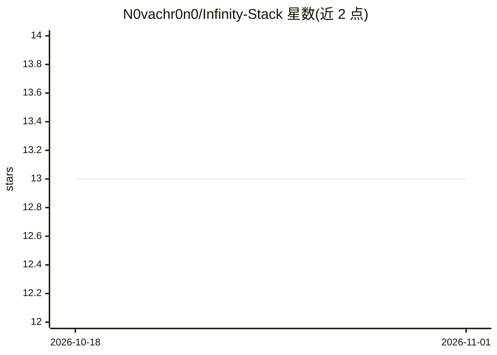

# N0vachr0n0/Infinity-Stack

⭐ 13 · 推送 2026-01-27 · [GitHub](https://github.com/N0vachr0n0/Infinity-Stack) · 个人维护

**网络安全与 DevOps 技术资源策展清单（法文 awesome-list）**

个人维护的法文技术资源聚合清单，按网络安全（CTF、红队、OSINT、取证、审计）、开发与 DevOps（CI/CD、容器化、应用开发）、云与基础设施（Linux、监控、自托管工具）、AI 与自动化（LLM 助手、AI 内容创作）等大类组织，收录数百个工具、课程、平台与文档链接。面向网络安全学习者与 DevOps 从业者作为资源导航使用，纯清单形式，不提供可安装的软件本体。

## 筛选速览

| 维度 | 判定 | 备注 |
|---|---|---|
| AI 角色 | `ai-knowledge` | 知识聚合/清单类 |
| 许可风险 | `none` | — |
| 部署形态 | `self-host` | docker 或自建部署 |
| 模型依赖 | — | README 未给出锁定关系 |
| 硬件要求 | — | 无带数字的原话,不猜 |
| 安装摩擦 | `low` | 无编译、无系统依赖或容器化 |
| 成熟度 | — | 结构信号不足 |

## 能力要点

- 按 CTF/红队/OSINT/取证/审计等 15+ 个子类组织安全资源
- 覆盖 DevOps、容器化、Linux 系统管理与监控工具条目
- 含 LLM 助手与 AI 内容创作工具的独立章节
- 全文以法文撰写

## 适用场景

- 按类别查找 CTF 练习平台与安全培训资源
- 搭建家庭实验室时寻找自托管与监控工具
- 了解法文社区的网络安全与 DevOps 学习路径

## 场景标签

`精选清单` · 领域:学习与行业

## 证据(README 行号)

> L1: # 🏴‍☠️ Caverne de Z3t5u - Ressources Tech & Cybersécurité
> L6: ## 🔐 Cybersécurité
> L259: ## 🤖 Intelligence Artificielle & Automation

## 星数曲线

2026-10-18 13 → 2026-11-01 13（+0）

---
*卡片 v1 · prompt 1.4 · 生成 2026-10-31 · 置信度 mid · 依据 README sha `d64ba7127b3b` · [字段定义](../../DATASET.md)*
