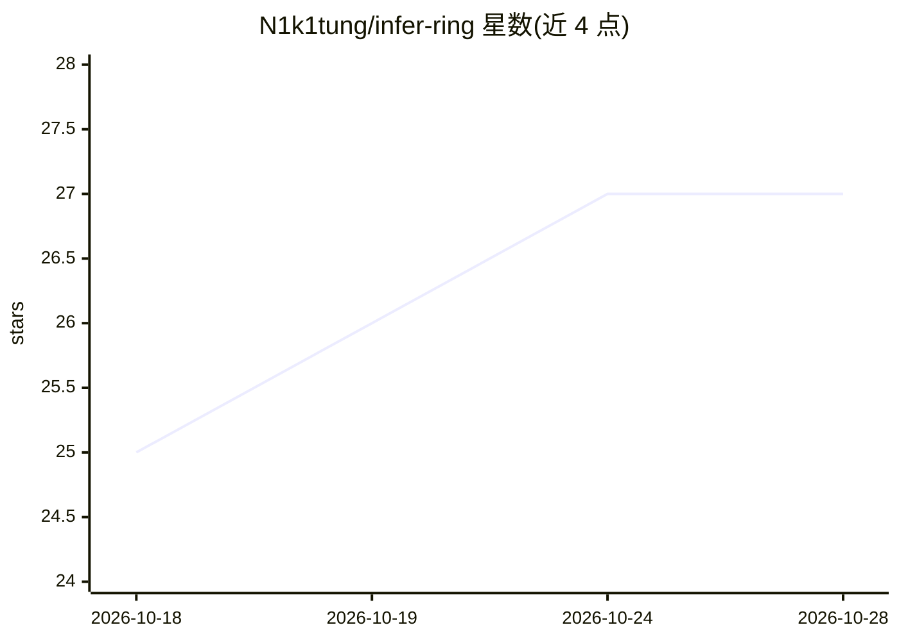

# N1k1tung/infer-ring

⭐ 27 · Swift · MIT · 推送 2026-05-19 · [GitHub](https://github.com/N1k1tung/infer-ring) · 个人维护

**跨 iOS/macOS 设备组合内存做本地 LLM 推理的应用**

基于 MLX 的 iOS 与 macOS 应用，通过在多台设备上运行同一应用实现分布式本地推理：设备经 Wi-Fi 或 USB 有线自动发现并互联，合并各机内存以加载单机放不下的模型。支持张量与流水线并行（默认后者，受连接方式限制）；批量预填速度略快、逐 token 生成略慢（需跨设备传输数据）。通过 App Store 分发，需 iOS/macOS 26.2+ 才能使用兼容设备上的神经加速内核。

## 筛选速览

| 维度 | 判定 | 备注 |
|---|---|---|
| AI 角色 | `ai-ecosystem` | LLM/agent 周边工具 |
| 许可风险 | `permissive` | MIT |
| 部署形态 | `None` |  |
| 模型依赖 | — | README 未给出锁定关系 |
| 硬件要求 | — | 无带数字的原话,不猜 |
| 安装摩擦 | `low` | 无编译、无系统依赖或容器化 |
| 成熟度 | — | 结构信号不足 |

## 能力要点

- 多设备合并 RAM 运行单机放不下的模型
- Wi-Fi 与 USB 有线自动发现连接，优先有线
- 支持张量与流水线两种并行模式（默认流水线）
- iOS/macOS 26.2+ 可用神经加速内核

## 适用场景

- 用 Mac 加 iPhone 的合并内存跑更大的本地模型
- USB 直连两台手机/平板做本地推理

## 场景标签

`推理引擎` · 领域:训练与推理

## 证据(README 行号)

> L3: Infer Ring enables local LLM inference by combining the memory of multiple iOS and macOS devices.
> L9: It supports both tensor and pipeline parallelism, defaulting to the latter - mainly because of the connection means.

## 星数曲线

2026-10-18 25 → 2026-10-28 27（+2）

---
*卡片 v1 · prompt 1.4 · 生成 2026-10-26 · 置信度 high · 依据 README sha `5fd36c1e7b29` · [字段定义](../../DATASET.md)*
