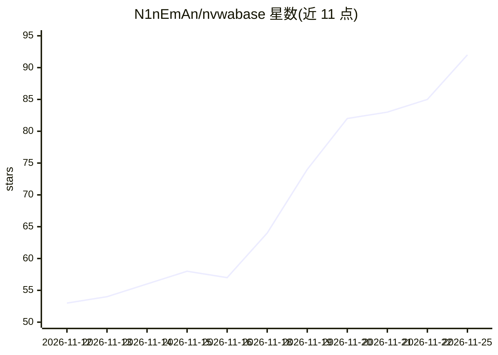

# N1nEmAn/nvwabase

⭐ 92 · Python · MIT · 推送 2026-11-11 · [GitHub](https://github.com/N1nEmAn/nvwabase) · [官网](https://github.com/N1nEmAn/sapper-v2) · 个人维护 · 中文 README

**给多智能体的分层事实-意图图谱共享记忆基础设施**

面向长周期多智能体协作的共享工作记忆底座：以分层事实-意图图谱（title/summary/evidence 三层）存储确认事实与工作意图，状态编码在图结构而非状态机中；提供 fgc CLI 实现类型化事实记录、子智能体分派（reason/explore/verify 等）、自主循环、语义检索经验复用、交互式 DAG 可视化与项目钩子。纯 Python 标准库实现、零依赖，单节点单 JSON 文件并以 flock 保证多智能体并发安全。限界：Create/Language 编排目前仍在 sapper-v2 项目中，本仓库仅交付 History 支柱。

## 筛选速览

| 维度 | 判定 | 备注 |
|---|---|---|
| AI 角色 | `ai-ecosystem` | LLM/agent 周边工具 |
| 许可风险 | `permissive` | MIT |
| 部署形态 | `None` |  |
| 模型依赖 | — | README 未给出锁定关系 |
| 硬件要求 | — | 无带数字的原话,不猜 |
| 安装摩擦 | `low` | 无编译、无系统依赖或容器化 |
| 成熟度 | — | 结构信号不足 |

## 能力要点

- 分层记忆（title/summary/doc），提示词默认只取摘要层，按需下钻
- 子智能体分派与 reason→explore→verify 自主循环，结论写回图谱
- 每节点一个 JSON 文件，flock + 原子写保证多智能体并发安全
- 纯标准库零依赖，bash install.sh 安装 fgc + nvwa CLI

## 适用场景

- 为多个 AI 会话提供可持续的共享记忆，个体会话结束后继任者接续任务
- 在 Claude Code 中通过钩子把图谱状态注入每轮对话
- 长周期协作工作（如渗透测试、研究、工程）中沉淀事实与经验并复用

## 场景标签

`Agent 记忆` `多智能体` `知识图谱` · 领域:Agent 开发

## 证据(README 行号)

> L5: > The ground on which AIs grow into civilizations: a **layered fact-intent
> L84: - **Concurrency-safe**: one JSON file per node, flock + atomic writes — many

## 星数曲线

2026-11-12 53 → 2026-11-25 92（+39）

---
*卡片 v1 · prompt 1.4 · 生成 2026-11-18 · 置信度 high · 依据 README sha `303c138265c4` · [字段定义](../../DATASET.md)*
