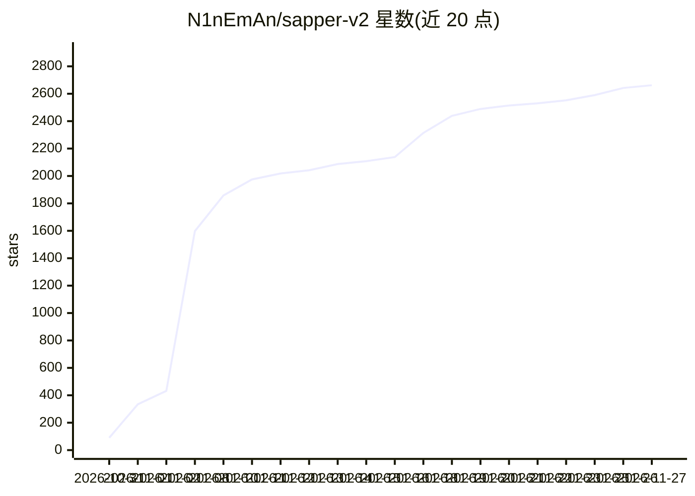

# N1nEmAn/sapper-v2

⭐ 2,662 · Python · MIT · 推送 2026-11-11 · [GitHub](https://github.com/N1nEmAn/sapper-v2) · [官网](https://github.com/N1nEmAn/nvwabase) · 个人维护 · 中文 README

**面向授权渗透测试的多 Agent 自主编排军团（CTF 冠军方案）**

sapper 是一个多 Agent 编排框架，不绑定具体模型或 CLI，每个角色背后的 agent 与模型均可替换（Claude Code/Codex/DeepSeek 等）。运行时由三个窗口组成：指挥官读盘调度、TMux 中的 AI 军团并行攻击、纯脚本 watchdog 负责保活与续跑。知识沉淀于分层事实-意图图谱（title/summary/evidence 三层），会话结束后由后继者接续。设计面向腾讯攻防挑战赛 CTF 场景，迁移到其他场景需改写教义与环境接线；提供 nvwabase 通用基座供任意长程协作场景迭代。仅限授权安全测试。

## 筛选速览

| 维度 | 判定 | 备注 |
|---|---|---|
| AI 角色 | `ai-native` | 本体是模型或模型工具 |
| 许可风险 | `permissive` | MIT |
| 部署形态 | `self-host` | docker 或自建部署 |
| 模型依赖 | — | README 未给出锁定关系 |
| 硬件要求 | — | 无带数字的原话,不猜 |
| 安装摩擦 | `low` | 无编译、无系统依赖或容器化 |
| 成熟度 | — | 结构信号不足 |

## 能力要点

- 多 Agent 编排：指挥官/将军/侦察兵/士兵分工，agent 与模型可自由替换
- 分层事实-意图图谱作为跨会话共享记忆
- 模型分层使用（指挥层与执行层用不同模型）
- 提供 nvwabase 通用基座（纯 Python stdlib、零依赖）

## 适用场景

- CTF 攻防竞赛中无人值守的多 Agent 自动解题
- 授权渗透测试的自动化编排
- 基于 nvwabase 搭建其他长程多 Agent 协作任务

## 场景标签

`多智能体` `网络安全` `Agent 记忆` · 领域:Agent 开发

## 证据(README 行号)

> L26: **sapper is a multi-agent orchestration harness, not a single agent.** It does
> L70: sapper is not a smarter single agent. It is a legion of AIs that divide labor,
> L99: sapper is the Nüwa foundation's first real campaign, in the penetration-testing

## 星数曲线

2026-10-31 90 → 2026-11-27 2,662（+2,572）

---
*卡片 v1 · prompt 1.4 · 生成 2026-11-23 · 置信度 high · 依据 README sha `8046d2b5b7a1` · [字段定义](../../DATASET.md)*
