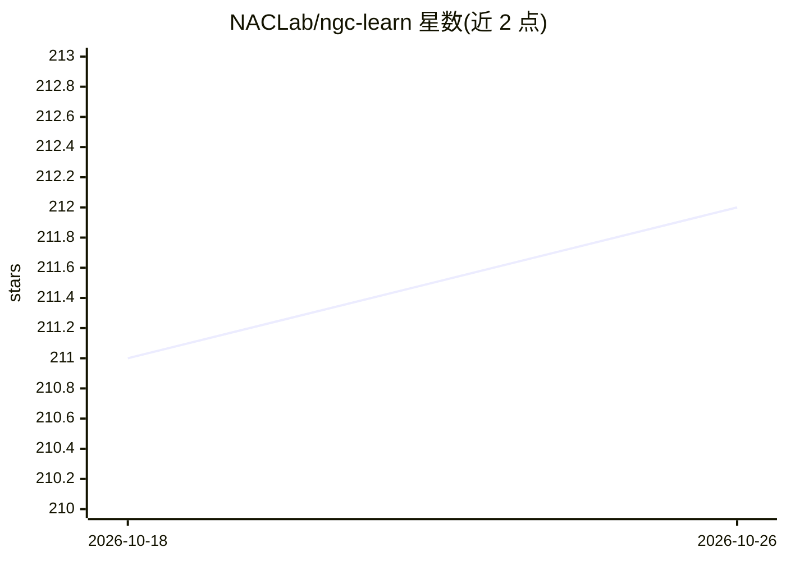

# NACLab/ngc-learn

⭐ 212 · Python · BSD-3-Clause · 推送 2026-10-24 · [GitHub](https://github.com/NACLab/ngc-learn) · [官网](https://ngc-learn.readthedocs.io/en/latest/#) · 组织维护

**计算神经科学研究库：构建与仿真生物合理的神经网络与智能体**

基于 JAX 的 Python 仿真工具库，用于构建、仿真和分析生物物理/神经生物学系统、脉冲神经网络、预测编码回路以及以生物合理方式学习的仿生（NeuroAI）智能体。面向计算神经科学与类脑计算研究者，由 NAC 实验室（RIT）维护。依赖 NumPy/SciPy/JAX 与自研 ngcsimlib，需 Python 3.12+；GPU 支持需另装 CUDA 12 版 JAX，Pascal 老架构 GPU 需固定 cuDNN 版本。配套文档、教程、模型博物馆仓库及 Nature Communications 论文。

## 筛选速览

| 维度 | 判定 | 备注 |
|---|---|---|
| AI 角色 | `ai-native` | 本体是模型或模型工具 |
| 许可风险 | `permissive` | BSD-3-Clause |
| 部署形态 | `library` | 以包/库形式分发 |
| 模型依赖 | — | README 未给出锁定关系 |
| 硬件要求 | — | 无带数字的原话,不猜 |
| 安装摩擦 | `high` | 编译与系统依赖俱全 |
| 成熟度 | — | 结构信号不足 |

## 能力要点

- 构建/仿真脉冲神经网络、预测编码回路与仿生智能体
- 基于 JAX，支持 CUDA 12 GPU 运行（默认 pip 安装为 CPU 版）
- 配套 ngc-museum 历史模型仓库与官方教程文档
- BSD 3-Clause 许可，附 Nature Communications 论文引用条目

## 适用场景

- 搭建生物合理学习规则的神经网络仿真实验
- 研究预测编码与脉冲神经计算模型
- 开发类脑（NeuroAI）学习智能体并分析其行为

## 场景标签

 · 领域:计算神经科学/类脑计算

## 证据(README 行号)

> L3:  ngc-learn is a Python library for building, simulating, and analyzing biophysical / neurobiological systems, spikin
> L18: You can find the related paper right here, which

## 星数曲线

2026-10-18 211 → 2026-10-26 212（+1）

---
*卡片 v1 · prompt 1.4 · 生成 2026-10-22 · 置信度 mid · 依据 README sha `12ec9ca14fe0` · [字段定义](../../DATASET.md)*
