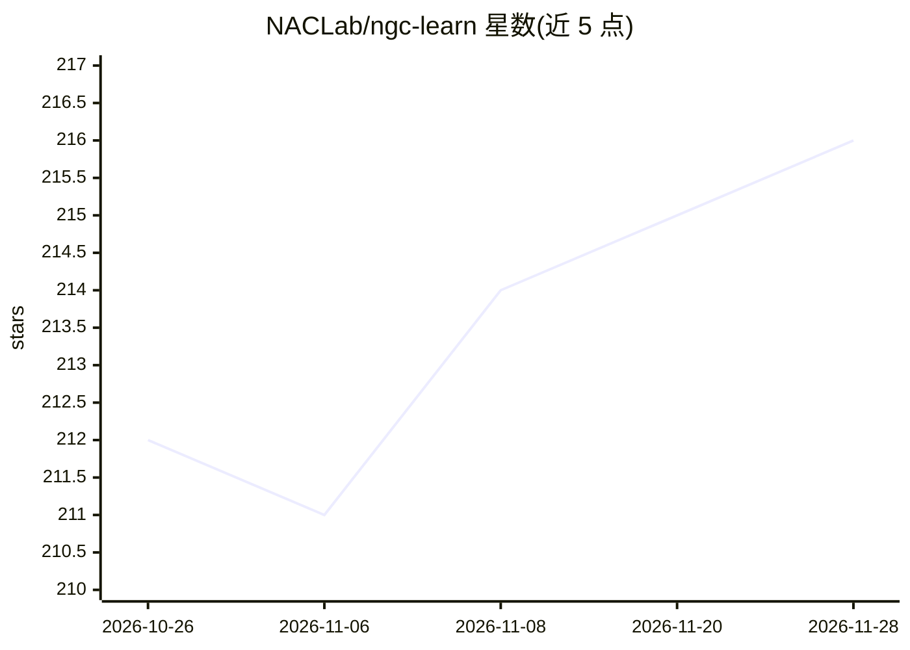

# NACLab/ngc-learn

⭐ 216 · Python · BSD-3-Clause · 推送 2026-11-07 · [GitHub](https://github.com/NACLab/ngc-learn) · [官网](https://ngc-learn.readthedocs.io/en/latest/#) · 组织维护

**面向计算神经科学与NeuroAI研究的生物可塑性神经网络仿真库**

基于 JAX 的 Python 仿真工具库，用于构建、模拟与分析生物物理系统、脉冲神经网络、预测编码回路及以生物可塑性方式学习的仿生 agent。面向计算神经科学与脑启发计算研究者，提供 Hebbian 局部学习、自由能、预测编码等学习算法实现，并附 ngc-museum 历史模型库。以 pip 包分发（BSD 3-clause），依赖 Python≥3.12、NumPy、SciPy、ngcsimlib 与 JAX；GPU 需 CUDA 版 JAX，早期 Tensorflow-2 版本不再支持。

## 筛选速览

| 维度 | 判定 | 备注 |
|---|---|---|
| AI 角色 | `ai-native` | 本体是模型或模型工具 |
| 许可风险 | `permissive` | BSD-3-Clause |
| 部署形态 | `library` | 以包/库形式分发 |
| 模型依赖 | — | README 未给出锁定关系 |
| 硬件要求 | — | 无带数字的原话,不猜 |
| 安装摩擦 | `high` | 编译与系统依赖俱全 |
| 成熟度 | — | 结构信号不足 |

## 能力要点

- 基于 JAX 构建的生物可塑性神经网络仿真与学习算法库
- 支持脉冲神经网络、预测编码回路与仿生 NeuroAI agent 建模
- 配套 ngc-museum 历史模型仓库与官方教程文档
- 源论文入选 Nature Neuromorphic Hardware and Computing Collection (2023)

## 适用场景

- 构建并模拟脉冲神经网络与预测编码回路
- 研究局部学习与生物可信的信用分配算法
- 复现计算神经科学与神经形态计算领域的已发表模型

## 场景标签

`科研工具` · 领域:学习与行业

## 证据(README 行号)

> L3:  ngc-learn is a Python library for building, simulating, and analyzing biophysical / neurobiological systems, spikin
> L6: Neural Adaptive Computing (NAC) laboratory.
> L139: Rochester Institute of Technology, Department of Computer Science

## 星数曲线

2026-10-26 212 → 2026-11-28 216（+4）

---
*卡片 v1 · prompt 1.4 · 生成 2026-11-25 · 置信度 high · 依据 README sha `5d11f13192f5` · [字段定义](../../DATASET.md)*
