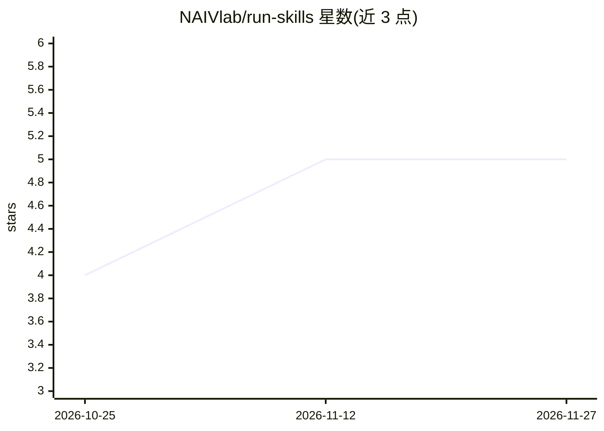

# NAIVlab/run-skills

⭐ 5 · Python · MIT · 推送 2026-11-19 · [GitHub](https://github.com/NAIVlab/run-skills) · 组织维护

**让编程 Agent 在 Slurm 集群/GPU 工作站上受控运行实验**

提供单个 agent skill（remote-run）、一个 bash harness 及 rsk 命令：用户用自然语言下达远程实验请求，Agent 同步项目、用 uv 或 conda 构建远程环境、展示计划并在授权通过后提交作业并持续监控。核心机制包括缓存与输出固定在项目目录内、fail-closed 校验、按既有授权范围先检查后提问、~2KB 状态摘要监控、smoke/train 等运行类别约定与 checkpoint 自动续跑契约。支持 Claude Code、OpenAI Codex 与 pi 三个 Agent 宿主，同一份安装即可；依赖 bash、git、rsync、ssh，目标机需 NVIDIA GPU。

## 筛选速览

| 维度 | 判定 | 备注 |
|---|---|---|
| AI 角色 | `ai-ecosystem` | LLM/agent 周边工具 |
| 许可风险 | `permissive` | MIT |
| 部署形态 | `self-host` | docker 或自建部署 |
| 模型依赖 | — | README 未给出锁定关系 |
| 硬件要求 | — | 无带数字的原话,不猜 |
| 安装摩擦 | `low` | 无编译、无系统依赖或容器化 |
| 成熟度 | — | 结构信号不足 |

## 能力要点

- 授权优先机制：提交/启动/取消先对照已批准计划或长期许可，超范围才询问
- 缓存与产物全部固定在项目目录，多目标间用带后缀的 venv 隔离
- rsk watch/status.sh 提供字节受限读取的约 2KB 运行摘要（状态、OOM/NaN 计数、wandb URL）
- 站点配置即数据：profile.sh/policy.sh/reference.md 目录，可打包为 target pack 共享

## 适用场景

- 让 Claude Code/Codex 把训练作业提交到实验室 Slurm 集群并代为盯进度
- 防止 Agent 误写 sbatch 参数、污染共享环境或占用同事的 GPU
- 实验室通过 target pack 统一共享集群站点配置
- 长时训练的 checkpoint 自动续跑与抢占自动恢复

## 场景标签

`编码 Agent` `MLOps` · 领域:编码与开发

## 证据(README 行号)

> L3: **Let your coding agent run experiments on Slurm clusters and GPU workstations — contained, authorised, and watched.
> L5: run-skills is one agent skill, `remote-run`, plus a small bash harness and its `rsk` command. You say *"run this on 
> L8: correctly sized job and keeps an eye on it. Works with **Claude Code**, **OpenAI Codex** and **pi** from one install

## 星数曲线

2026-10-25 4 → 2026-11-27 5（+1）

---
*卡片 v1 · prompt 1.4 · 生成 2026-11-21 · 置信度 mid · 依据 README sha `43a25234bce1` · [字段定义](../../DATASET.md)*
