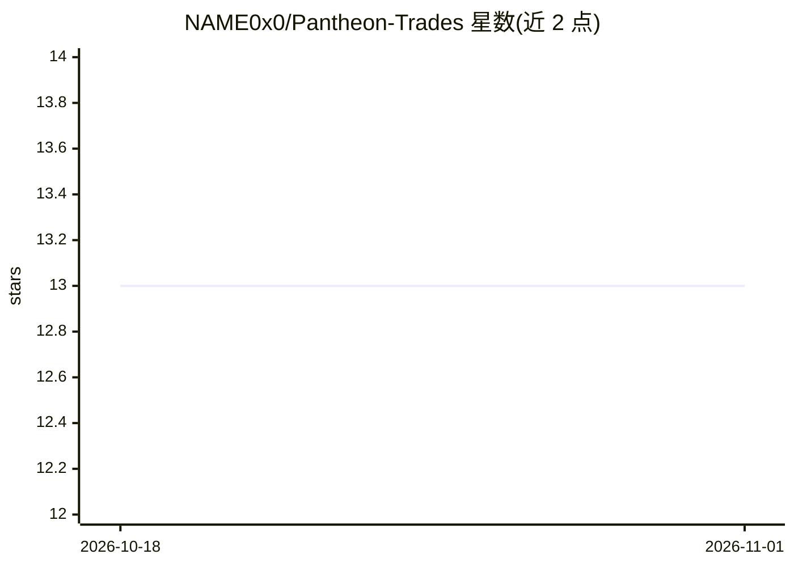

# NAME0x0/Pantheon-Trades

⭐ 13 · Python · MIT · 推送 2026-05-25 · [GitHub](https://github.com/NAME0x0/Pantheon-Trades) · [官网](https://pantheon-trades.vercel.app) · 个人维护

**11 个 AI agent 议会审议预测市场交易的系统，拒单上链存证**

面向预测市场（Polymarket CLOB）的多 agent 交易系统：11 个具名角色的 LLM agent 分四轮审议每笔交易（多头/空头研究员、风险官、合规官、对抗性少数派等，Zeus 与 Solon 可单方否决），配半 Kelly 仓位、5% NAV 单仓上限与 EV 门槛（净 EV t 统计≥2.0 才放行）；被拒交易以 Restrained 事件写入 Arc Testnet 合约供审计。Python monorepo + FastAPI 网关 + Next.js 14 + Foundry 合约，支持 11 家 LLM 提供商单一环境变量切换。局限：尚无实盘 Polymarket 执行，回测 Brier 0.149 未跑赢人类共识 0.126。

## 筛选速览

| 维度 | 判定 | 备注 |
|---|---|---|
| AI 角色 | `ai-native` | 本体是模型或模型工具 |
| 许可风险 | `permissive` | MIT |
| 部署形态 | `self-host` | docker 或自建部署 |
| 模型依赖 | local-ok | 支持本地模型 |
| 硬件要求 | — | 无带数字的原话,不猜 |
| 安装摩擦 | `low` | 无编译、无系统依赖或容器化 |
| 成熟度 | — | 结构信号不足 |

## 能力要点

- 11 角色四轮审议，两个 agent 可单方否决
- 拒单以链上 Restrained 事件存证（Arc Testnet）
- 半 Kelly 仓位 + 宪法式仓位上限 + EV t 统计门槛
- 单一环境变量接入 11 家 LLM 提供商，含有序 fallback 链

## 适用场景

- 跑本地完整栈观察 agent 议会的交易审议流程
- 在测试网上见证与签发交易意图（/demo、/trade）
- 复现 200 个市场的评估实验（/methodology 提供命令）

## 场景标签

`多智能体` `金融量化` · 领域:Agent 开发

## 证据(README 行号)

> L38: A trading system that won't put a single dollar on a market until eleven AI agents fight about it. The agents have 
> L49: 4. **Run the whole stack locally.** `git clone`, then either click the Codespaces / Gitpod badge above (no terminal
> L64: **`/demo` is LLM-free, `/trade` is LLM-free.** The four scenarios on `/demo` are captured JSON bundles replayed eve

## 星数曲线

2026-10-18 13 → 2026-11-01 13（+0）

---
*卡片 v1 · prompt 1.4 · 生成 2026-10-31 · 置信度 high · 依据 README sha `979495a0b575` · [字段定义](../../DATASET.md)*
