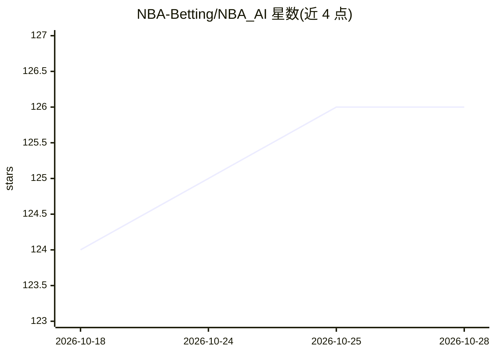

# NBA-Betting/NBA_AI

⭐ 126 · Python · MIT · 推送 2026-10-12 · [GitHub](https://github.com/NBA-Betting/NBA_AI) · [官网](https://nba-ai.us) · 个人维护

**用深度学习与传统 ML 预测 NBA 比赛让分与胜负的系统**

从 NBA API 与 ESPN 自动采集比赛、盒得分、逐回合、伤停与博彩盘口数据存入 SQLite，由多个预测引擎（分层神经网络、Transformer、Ridge、XGBoost、MLP 及集成）生成赛前让分与胜负预测，并以 Vegas 收盘线评估表现。Flask Web 应用展示预测与实际结果，并提供模型表现追踪仪表盘。提供含训练模型的入门数据库，深度学习模型需自行训练；作者声明为无质量保证的个人项目。

## 筛选速览

| 维度 | 判定 | 备注 |
|---|---|---|
| AI 角色 | `ai-native` | 本体是模型或模型工具 |
| 许可风险 | `permissive` | MIT |
| 部署形态 | `None` |  |
| 模型依赖 | — | README 未给出锁定关系 |
| 硬件要求 | — | 无带数字的原话,不猜 |
| 安装摩擦 | `low` | 无编译、无系统依赖或容器化 |
| 成熟度 | — | 结构信号不足 |

## 能力要点

- 每日自动化流水线：采集数据、更新球员能力模型、生成全场预测
- 多预测引擎：分层深度学习（Phase5/Phase3）+ 传统 ML（Ridge/XGBoost/MLP）+ 集成
- Flask Web 应用与模型表现仪表盘，以 Vegas 收盘线评估 ATS 表现
- 入门数据库包含四个开箱即用的已训练模型

## 适用场景

- 运行完整的 NBA 赛果预测流水线并查看每日预测
- 追踪多个模型相对 Vegas 盘口的长期表现
- 在历史数据上训练自己的深度学习预测模型

## 场景标签

`金融量化` · 领域:学习与行业

## 证据(README 行号)

> L9: #### Using AI to predict the outcomes of NBA games.
> L21: * **Prediction Models** — Multiple prediction engines analyze the data and generate pre-game spread and winner pred

## 星数曲线

2026-10-18 124 → 2026-10-28 126（+2）

---
*卡片 v1 · prompt 1.4 · 生成 2026-10-23 · 置信度 high · 依据 README sha `03feec1c3d8e` · [字段定义](../../DATASET.md)*
