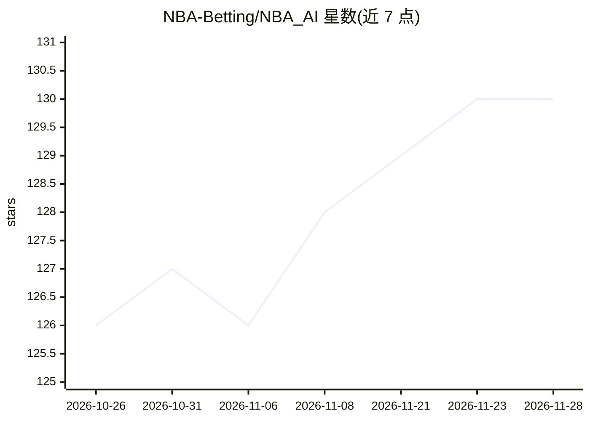

# NBA-Betting/NBA_AI

⭐ 130 · Python · MIT · 推送 2026-11-21 · [GitHub](https://github.com/NBA-Betting/NBA_AI) · [官网](https://nba-ai.us) · 个人维护

**用深度学习与 ML 模型预测 NBA 比赛让分与胜负的系统**

自动化日更流水线：从 NBA API、ESPN、Covers 采集比赛数据、球员数据、伤病与盘口写入 SQLite，多个预测引擎生成赛前让分与胜负预测，Flask 网页应用展示预测与 Vegas 盘口对比，仪表盘跟踪各模型实际表现。包含 4 层分层神经网络、Transformer、Ridge/XGBoost/MLP 及等权集成等引擎；附带预训练的四个轻量模型，深度模型需自行用完整历史数据训练，首次回填数据可能耗时 10-30 分钟以上。

## 筛选速览

| 维度 | 判定 | 备注 |
|---|---|---|
| AI 角色 | `ai-native` | 本体是模型或模型工具 |
| 许可风险 | `permissive` | MIT |
| 部署形态 | `None` |  |
| 模型依赖 | — | README 未给出锁定关系 |
| 硬件要求 | — | 无带数字的原话,不猜 |
| 安装摩擦 | `low` | 无编译、无系统依赖或容器化 |
| 成熟度 | — | 结构信号不足 |

## 能力要点

- 多预测引擎：分层神经网络、Transformer、Ridge/XGBoost/MLP 与等权集成
- 自动采集 NBA API、ESPN、Covers 数据入 SQLite，支持 cron 定时更新
- 仪表盘跟踪各模型赛前预测的实时战绩与回测
- 附带预训练模型开箱即用，深度模型提供训练脚本

## 适用场景

- 获取每日 NBA 比赛的赛前让分与胜负预测
- 对比各预测模型与 Vegas 收盘线的准确度
- 跟踪模型在整个赛季中的实际预测记录

## 场景标签

 · 领域:体育数据分析/预测

## 证据(README 行号)

> L9: #### Using AI to predict the outcomes of NBA games.
> L21: * **Prediction Models** — Multiple prediction engines analyze the data and generate pre-game spread and winner pred

## 星数曲线

2026-10-26 126 → 2026-11-28 130（+4）

---
*卡片 v1 · prompt 1.4 · 生成 2026-11-28 · 置信度 high · 依据 README sha `71ff3753ab83` · [字段定义](../../DATASET.md)*
