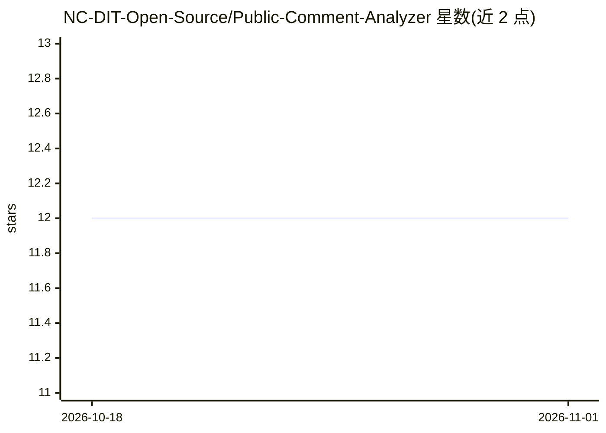

# NC-DIT-Open-Source/Public-Comment-Analyzer

⭐ 12 · Python · Apache-2.0 · 推送 2026-10-30 · [GitHub](https://github.com/NC-DIT-Open-Source/Public-Comment-Analyzer)

**政府公共意见批量分析工具：上传表格获取逐条分析与汇总**

面向公共意见征询场景的分析应用：上传 CSV/XLSX，指定分析列，系统通过 LangChain 聊天模型与有界 LangGraph 工作流生成逐条草稿分析（分类、见解）及汇总摘要，并保留原数据下载。模型提供方、凭据、存储与认证均在代码外配置，支持 OpenAI、Anthropic、Bedrock、Ollama 等多种提供方，也提供不调用真实模型的演示模式。模型无工具、shell 或浏览器访问；输出定位为草稿决策辅助，需人工复核。本地运行基于 uv 与 Node.js 24.x，亦可用 Docker/Terraform 部署。

## 筛选速览

| 维度 | 判定 | 备注 |
|---|---|---|
| AI 角色 | `ai-native` | 本体是模型或模型工具 |
| 许可风险 | `permissive` | Apache-2.0 |
| 部署形态 | `None` |  |
| 模型依赖 | local-ok | 支持本地模型 |
| 硬件要求 | — | 无带数字的原话,不猜 |
| 安装摩擦 | `low` | 无编译、无系统依赖或容器化 |
| 成熟度 | — | 结构信号不足 |

## 能力要点

- CSV/XLSX 输入，输出逐条草稿分析与汇总摘要
- 基于 LangChain/LangGraph，支持 6 种模型提供方（含本地 Ollama）
- 演示模式无需云账号或付费模型即可体验完整流程
- 50 行以上分类文件在 20 行预览后暂停等待人工确认

## 适用场景

- 政府部门批量分析公众提交的意见评论
- 在汇总政策反馈前对每条评论做草稿分类与见解提取
- 用演示模式在本地体验完整分析流程

## 场景标签

`数据分析` · 领域:效率与自动化

## 证据(README 行号)

> L3: Upload CSV or XLSX comments, define analysis columns, review sample classifications, then download the original data
> L25: Edit `.env`: set `LLM_PROVIDER` and `LLM_MODEL` to a provider and model/deployment you have access to. Put your API
> L48: - Output is a draft decision aid. Review it before policy, legal or other consequential use; changing models can ch

## 星数曲线

2026-10-18 12 → 2026-11-01 12（+0）

---
*卡片 v1 · prompt 1.4 · 生成 2026-11-01 · 置信度 high · 依据 README sha `d66a82c909ef` · [字段定义](../../DATASET.md)*
