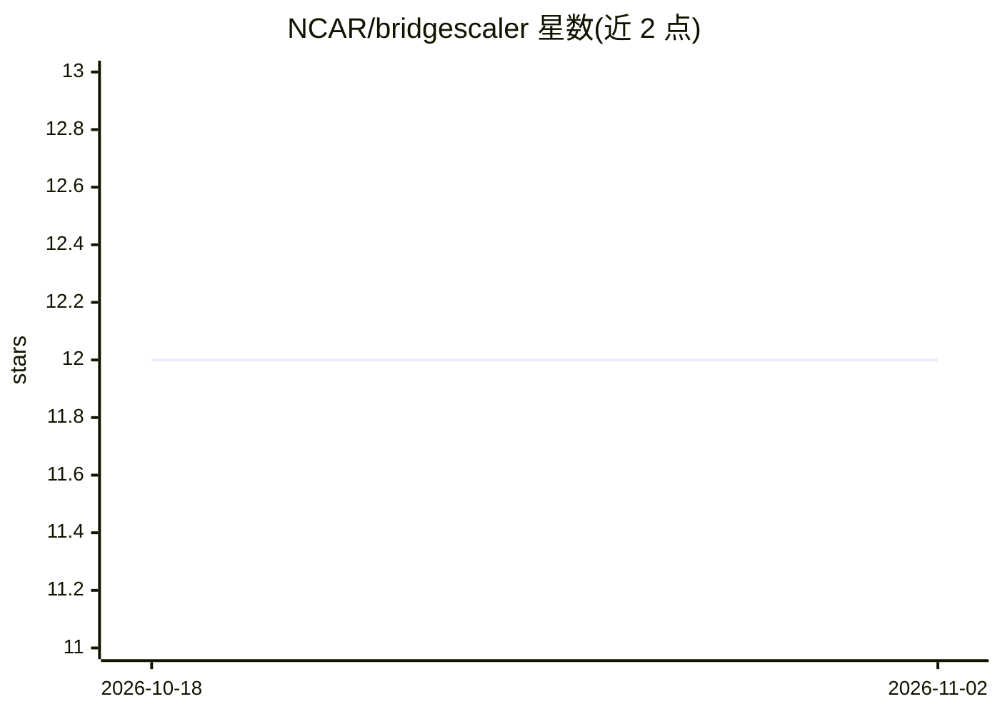

# NCAR/bridgescaler

⭐ 12 · Python · MIT · 推送 2026-10-24 · [GitHub](https://github.com/NCAR/bridgescaler) · [官网](https://bridgescaler.readthedocs.io/) · 组织维护

**跨会话保存/复用与分布式计算 scikit-learn 缩放器参数的 Python 库**

由 NCAR 维护的 Python 库，解决 scikit-learn 风格缩放器参数在会话与用户间共享的问题：将缩放器属性保存为 JSON 并可重新加载。提供分布式缩放器，可在不同数据子集上分别计算缩放参数再合并，支持 numpy/pandas/xarray 及可选的 PyTorch Tensor 版本（CPU/GPU，含逐格点空间标准化与 TDigest 分位数拟合）。另有组缩放器与面向 CNN 输入的深度缩放器。限制：TDigest 单变量拟合比 crick 后端慢，依赖 numba 并行获取加速。

## 筛选速览

| 维度 | 判定 | 备注 |
|---|---|---|
| AI 角色 | `ai-ecosystem` | LLM/agent 周边工具 |
| 许可风险 | `permissive` | MIT |
| 部署形态 | `library` | 以包/库形式分发 |
| 模型依赖 | — | README 未给出锁定关系 |
| 硬件要求 | — | 无带数字的原话,不猜 |
| 安装摩擦 | `medium` | 含编译或系统依赖之一 |
| 成熟度 | — | 结构信号不足 |

## 能力要点

- 缩放器参数保存为 JSON 并跨会话/用户复用
- 分布式缩放器：子集分别拟合后合并，支持 numpy/pandas/xarray
- 可选 PyTorch Tensor 版本，直接操作 torch.Tensor，CPU/GPU 均可运行
- 组缩放器与面向深度学习 2D/3D 场的深度缩放器

## 适用场景

- 多进程训练中在数据分片上分别计算归一化统计量再合并
- 将拟合好的缩放器分发给其他用户或推理流程复用
- 为 CNN 输入的气象/多维场数据做逐通道或逐格点标准化

## 场景标签

 · 领域:机器学习数据预处理/科学计算

## 证据(README 行号)

> L3: Bridgescaler allows you to save the properties of a scikit-learn-style scaler object
> L167: The deep scalers are designed to scale 2 or 3-dimensional fields input into a

## 星数曲线

2026-10-18 12 → 2026-11-02 12（+0）

---
*卡片 v1 · prompt 1.4 · 生成 2026-11-01 · 置信度 high · 依据 README sha `f3e9280a59ca` · [字段定义](../../DATASET.md)*
