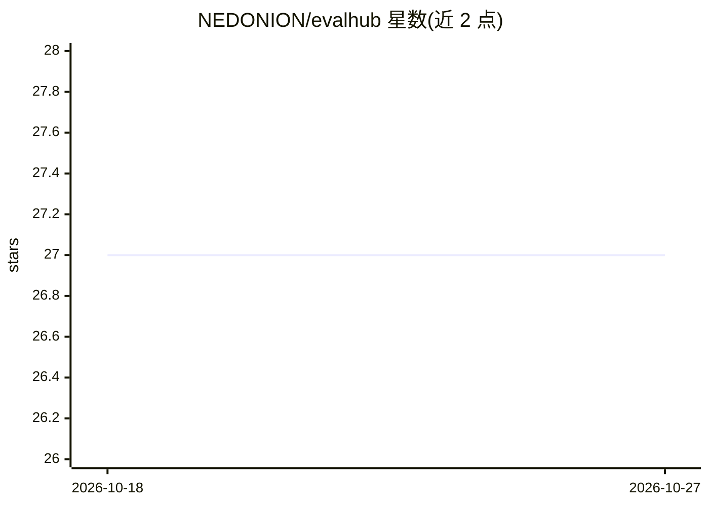

# NEDONION/evalhub

⭐ 27 · Python · MIT · 推送 2026-08-15 · [GitHub](https://github.com/NEDONION/evalhub) · 个人维护 · 中文 README

**本地优先的 LLM 与编码 Agent Benchmark 评测平台**

面向本地 LLM 开发的统一评测平台：在公开数据集（MMLU/IFEval/GSM8K/BBH/HumanEval 等）上运行模型评测，通过 Ollama 调用本地模型，也可评测 DeepSeek API 等托管模型；同时将 Pi CLI、MiniClaw 等完整编码 Agent 置于同一任务与隐藏验证器下评测。每次运行保留样本级结果、节点状态、资源指标与审计证据，以持久化 DAG 记录，输出知识与安全等六维能力报告。技术栈为 Python 3.11+ 与 React 19，代码评测需 Docker。

## 筛选速览

| 维度 | 判定 | 备注 |
|---|---|---|
| AI 角色 | `ai-ecosystem` | LLM/agent 周边工具 |
| 许可风险 | `permissive` | MIT |
| 部署形态 | `library` | 以包/库形式分发 |
| 模型依赖 | local-ok | 支持本地模型 |
| 硬件要求 | — | 无带数字的原话,不猜 |
| 安装摩擦 | `low` | 无编译、无系统依赖或容器化 |
| 成熟度 | — | 结构信号不足 |

## 能力要点

- 在真实公开数据集上运行模型评测并保留样本级结果
- 通过 Ollama 调用本地模型，支持 DeepSeek/SiliconFlow API 模型参与同一套件
- 以持久化 DAG 记录节点状态、检查点、重试、资源指标与审计事件
- 六维能力报告：模型版与 Agent 版各六维，未评测维度不记 0 分

## 适用场景

- 本地模型选型时跑同一套 Benchmark 得到可复现对比
- 对 Pi CLI、MiniClaw 等编码 Agent 做同任务同验证器的评测
- 回放 Agent 消息、工具调用与失败样本做审计

## 场景标签

`模型评测` · 领域:评测与运维

## 证据(README 行号)

> L23: EvalHub is a unified evaluation platform for local LLM development. It runs real public benchmarks
> L38: |**Model benchmarks**|Run real public datasets, call local models through Ollama, and keep sample-level results alo
> L39: |**Agent evaluation**|Run complete agents — Pi CLI or MiniClaw — through a controlled registry, sharing Coding Mini

## 星数曲线

2026-10-18 27 → 2026-10-27 27（+0）

---
*卡片 v1 · prompt 1.4 · 生成 2026-10-26 · 置信度 mid · 依据 README sha `e16e0a3f0e83` · [字段定义](../../DATASET.md)*
