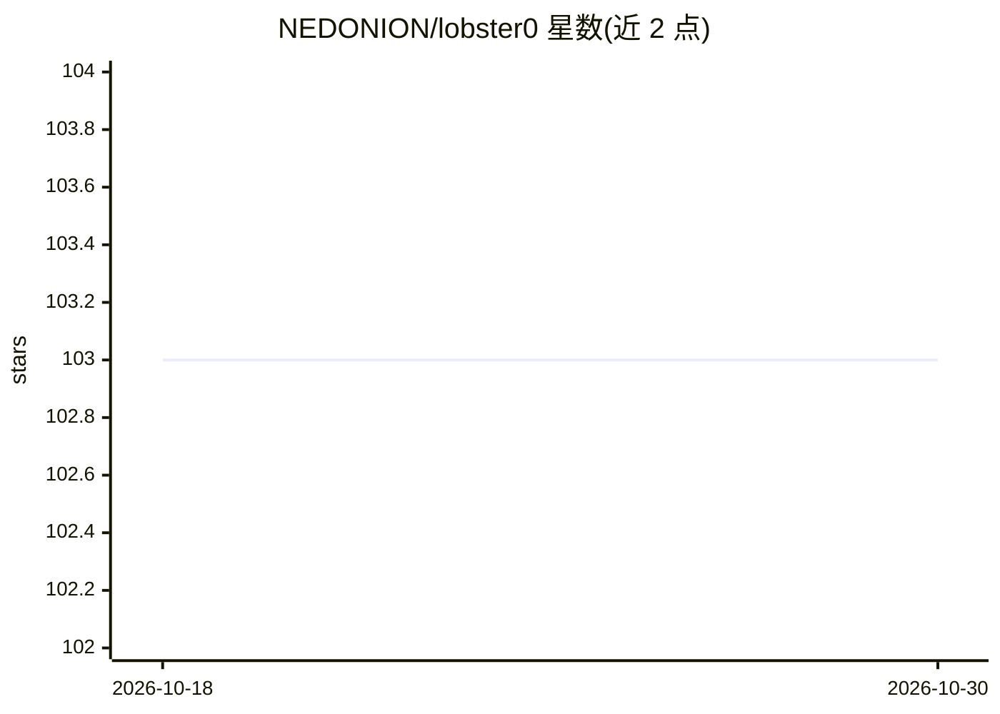

# NEDONION/lobster0

⭐ 103 · Python · MIT · 推送 2026-10-26 · [GitHub](https://github.com/NEDONION/lobster0) · [官网](https://lobster0.jchu.tech) · 个人维护 · 中文 README

**自托管个人 AI Agent：聊天加受控执行本机任务**

运行在用户自己机器上的个人 Agent（v0.7.0 预发布）：通过 Desktop、TUI、Web 控制台及飞书/Telegram/Discord 多入口共享同一 Runtime、Memory 与审计记录。模型只提出 Tool Call，参数校验、权限判断、审批与执行由本地 Core 完成；提供 18+8 个本机/网页工具、四档 Permission Mode、Markdown 真相源+SQLite 检索的 Memory、定时任务与 Docker/Seatbelt 沙箱。安装通过 GitHub Release 的 wheel（uv tool install），源码运行需 Python 3.12+ 与 Node.js 22/24。一行安装、PyPI 发布与真实平台 Live Gate 均未完成。

## 筛选速览

| 维度 | 判定 | 备注 |
|---|---|---|
| AI 角色 | `ai-native` | 本体是模型或模型工具 |
| 许可风险 | `permissive` | MIT |
| 部署形态 | `library` | 以包/库形式分发 |
| 模型依赖 | — | README 未给出锁定关系 |
| 硬件要求 | — | 无带数字的原话,不猜 |
| 安装摩擦 | `low` | 无编译、无系统依赖或容器化 |
| 成熟度 | `idea` | |

## 能力要点

- 模型仅提出 Tool Call，校验/审批/执行由本地 Core 负责
- 飞书/Telegram/Discord/桌面端共享同一 Runtime 与 Memory
- 四档 Permission Mode 与不可关闭的安全硬边界
- Memory Autopilot：Markdown 真相源 + SQLite 可重建检索投影

## 适用场景

- 把会议记录、仓库检查、网页查询等事交给 Agent 在本机完成
- 在飞书私聊中继续操作与审批同一个 Agent
- 每天定时汇总工作（可暂停/恢复的自动化任务）

## 场景标签

`AI 助手` · 领域:对话与助手

## 证据(README 行号)

> L3: **一个装在自己电脑上的个人 Agent：能聊天，也能在你允许后真正把事情做完。**
> L61: 你可以把会议记录、代码仓库、文件整理、网页查询或定时任务交给 Lobster0。它会先理解目标，
> L82: 它不是“把聊天框直接接到 Shell”。模型只能提出 Tool Call；真正的参数校验、权限判断、审批、执行、

## 星数曲线

2026-10-18 103 → 2026-10-30 103（+0）

---
*卡片 v1 · prompt 1.4 · 生成 2026-10-23 · 置信度 mid · 依据 README sha `4ab80ded399d` · [字段定义](../../DATASET.md)*
