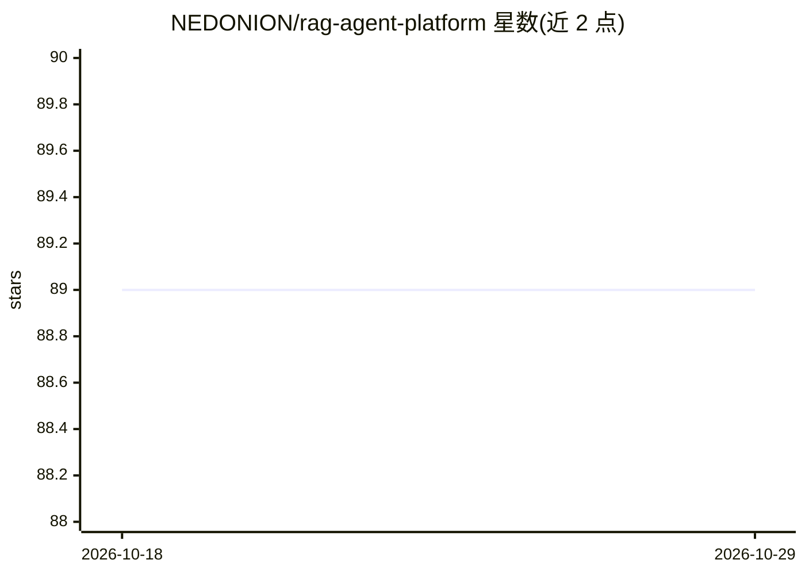

# NEDONION/rag-agent-platform

⭐ 89 · Java · MIT · 推送 2026-08-18 · [GitHub](https://github.com/NEDONION/rag-agent-platform) · [官网](http://39.97.58.27/explore) · 个人维护 · 中文 README

**自托管 RAG 智能体平台：知识库、Agent 与 MCP 工具统一工作台**

以 Spring Boot 3.2.3（Java 17）、Next.js 15 与 LangChain4j 构建的自托管平台：上传文档经 RabbitMQ 异步处理写入 PostgreSQL+PGVector，支持向量检索；可配置模型/重排服务，创建并发布 Agent，会话以 SSE 流式返回；Agent 可接入手工配置的 MCP 网关与工具容器（UI 暂无完整工具导入流程）。面向需要控制数据与部署的团队，附阿里云在线 Demo 与部署参考（Docker Compose 需外部数据库与私有镜像仓库，非一键安装）。

## 筛选速览

| 维度 | 判定 | 备注 |
|---|---|---|
| AI 角色 | `ai-native` | 本体是模型或模型工具 |
| 许可风险 | `permissive` | MIT |
| 部署形态 | `self-host` | docker 或自建部署 |
| 模型依赖 | — | README 未给出锁定关系 |
| 硬件要求 | — | 无带数字的原话,不猜 |
| 安装摩擦 | `low` | 无编译、无系统依赖或容器化 |
| 成熟度 | — | 结构信号不足 |

## 能力要点

- 文档摄取 + PGVector 向量检索 + RAG 会话的完整链路
- 多模型服务配置、Agent 发布与他人对话（SSE 流式）
- MCP 网关与工具容器集成（需手工配置）
- 基于 Docker Compose 的部署参考与 CI/CD、回滚流程

## 适用场景

- 团队私有化部署带知识库检索的对话 Agent
- 在自有基础设施上统一管理知识库、模型服务与工具
- 将已配置的 MCP 工具接入 Agent 会话

## 场景标签

`RAG` `文档问答` · 领域:知识与检索

## 证据(README 行号)

> L24: From document ingestion and vector retrieval to user-facing Agent conversations, this project brings the core RAG w
> L35: |**Configurable Agents**|Configure model providers, manage and publish Agents, and stream conversation responses ov

## 星数曲线

2026-10-18 89 → 2026-10-29 89（+0）

---
*卡片 v1 · prompt 1.4 · 生成 2026-10-23 · 置信度 mid · 依据 README sha `e08215ebf5f2` · [字段定义](../../DATASET.md)*
