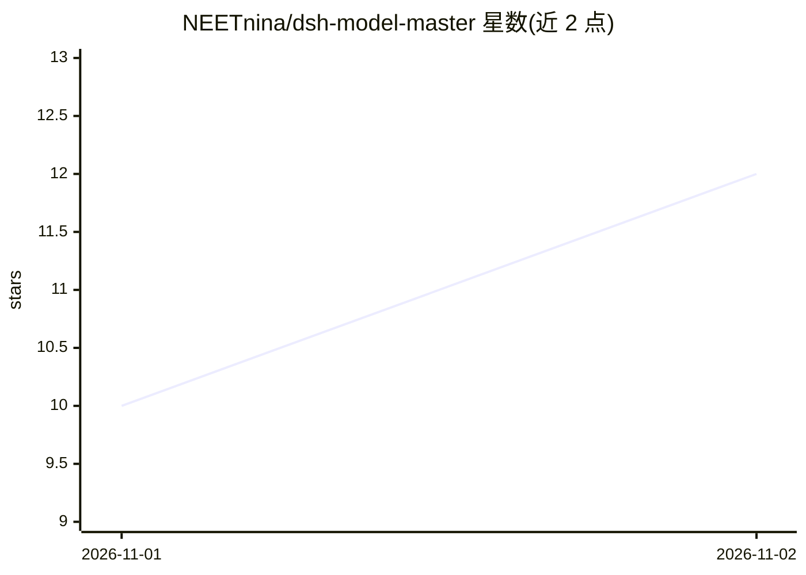

# NEETnina/dsh-model-master

⭐ 12 · JavaScript · MIT · 推送 2026-10-31 · [GitHub](https://github.com/NEETnina/dsh-model-master) · [官网](https://neetnina.github.io/dsh-model-master/) · 个人维护 · 中文 README

**DeepSeek Harness 的模型选择插件：搜索、真实测速与全球榜单**

DSH（DeepSeek Harness）的组合包插件，把原生模型下拉列表接管为可搜索的大面板：按渠道分组全局搜索与「智能优选」；对任意模型发起真实流式请求测出 TTFT/TPS（服务端计时，失败如实显示）；展示基于 OpenRouter 目录的 Artificial Analysis 指数 TOP100 榜单，点击行可跳转本机同名渠道搜索。附 15 语言界面、版本更新三态检查、loopback-only HTTP API。需 DSH 0.2.x 与 Node.js ≥20，通过 dsh plugin 命令安装，纯 JS 无构建步骤。

## 筛选速览

| 维度 | 判定 | 备注 |
|---|---|---|
| AI 角色 | `ai-ecosystem` | LLM/agent 周边工具 |
| 许可风险 | `permissive` | MIT |
| 部署形态 | `library` | 以包/库形式分发 |
| 模型依赖 | locked-api |  |
| 硬件要求 | — | 无带数字的原话,不猜 |
| 安装摩擦 | `low` | 无编译、无系统依赖或容器化 |
| 成熟度 | — | 结构信号不足 |

## 能力要点

- 真实流式测速测出 TTFT（ms）与 TPS（tok/s），支持 ×1/×3 中位数模式
- TOP100 全球榜单按 Artificial Analysis 智能指数排序，每日同步
- 测速结果仅由服务端产出，附带输出样本与 token 来源可审计
- 15 语言界面，含阿拉伯语/乌尔都语自动 RTL

## 适用场景

- 模型一多时在 DSH 里快速搜索和切换模型
- 对候选模型实测首字延迟与吞吐再决定用哪个
- 对照全球榜单了解模型表现并跳转本地同名渠道

## 场景标签

 · 领域:LLM 工具/模型选择

## 证据(README 行号)

> L10: > A Spotlight-style model switcher for **DeepSeek Harness (DSH)** — with real streaming speed probes, a live global
> L49: 2. **看得见快** — 对任意模型发起**真实流式请求**，测出 TTFT（首字延迟，ms）与 TPS（生成吞吐，tok/s）。
> L197: - 测速请求走 DSH **自己的** LLM provider 运行时，插件本身**不接触、不存储、不打印任何密钥**。

## 星数曲线

2026-11-01 10 → 2026-11-02 12（+2）

---
*卡片 v1 · prompt 1.4 · 生成 2026-11-02 · 置信度 high · 依据 README sha `8faca9f09138` · [字段定义](../../DATASET.md)*
