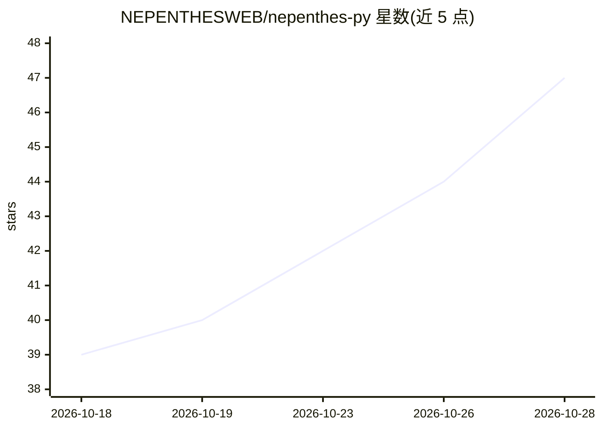

# NEPENTHESWEB/nepenthes-py

⭐ 47 · Python · MIT · 推送 2026-03-03 · [GitHub](https://github.com/NEPENTHESWEB/nepenthes-py) · 组织维护

**网站主的反 AI 爬虫陷阱：用无限假页面困住 LLM 爬虫**

原始 Lua 版 Nepenthes 的 Python 重写：向 LLM 爬虫提供无限生成的假页面迷宫，每页含 10-40 个内链、无出口，内容由内存 Markov 链生成；以逐字节滴流响应（默认 10-65 秒延迟）拖慢爬虫，向训练数据投毒。面向不希望内容被抓取的网站管理员，通过 nginx 反代接入，支持 Docker 与源码运行、多 silo 实例与统计 API。README 自称恶意软件并警示高 CPU 负载与搜索引擎除名风险。

## 筛选速览

| 维度 | 判定 | 备注 |
|---|---|---|
| AI 角色 | `ai-enhanced` | 去掉 AI 部分产品仍成立 |
| 许可风险 | `permissive` | MIT |
| 部署形态 | `self-host` | docker 或自建部署 |
| 模型依赖 | — | README 未给出锁定关系 |
| 硬件要求 | — | 无带数字的原话,不猜 |
| 安装摩擦 | `low` | 无编译、无系统依赖或容器化 |
| 成熟度 | — | 结构信号不足 |

## 能力要点

- 无限假页面迷宫，同 URL 确定性生成同一页面
- Markov 链从语料生成无意义文本
- 逐字节滴流响应（默认 10-65 秒延迟）与可配置 302 重定向链
- 多 silo 虚拟主机与 /stats 系列 API

## 适用场景

- 阻止 AI 爬虫抓取我的真实网站内容
- 拖慢并消耗恶意爬虫的资源
- 查看爬虫命中、流量与 User-Agent 统计

## 场景标签

`网络安全` · 领域:学习与行业

## 证据(README 行号)

> L5:  The first anti-AI tarpit. Rewritten in Python.
> L29: It generates an **endless sequence of fake pages**, each containing dozens of links that lead deeper into the maze.
> L61: |**Markov Babble**|In-memory Markov chain generates convincing nonsense from a trained corpus.|

## 星数曲线

2026-10-18 39 → 2026-10-28 47（+8）

---
*卡片 v1 · prompt 1.4 · 生成 2026-10-25 · 置信度 mid · 依据 README sha `cef241299026` · [字段定义](../../DATASET.md)*
