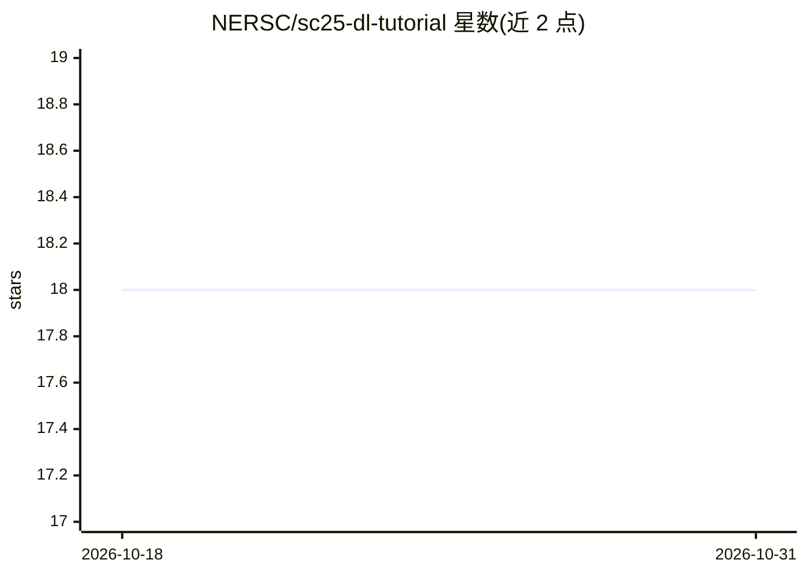

# NERSC/sc25-dl-tutorial

⭐ 18 · Python · 推送 2026-09-09 · [GitHub](https://github.com/NERSC/sc25-dl-tutorial) · 组织维护

**SC25 大规模深度学习教程示例代码：分布式训练 ViT 天气预报模型**

NERSC 为 SC25 教程 Deep Learning at Scale 提供的示例代码仓库：以 PyTorch 实现 ViT 架构，在 ERA5 再分析数据（空间降采样版）上训练数据驱动天气预报模型，覆盖单 GPU 训练、Nsight Systems 性能剖析与优化、数据并行/模型并行（channel-wise tensor parallelism）等内容。面向教程参与者在 NERSC Perlmutter 超算上通过 JupyterHub、SLURM 与 shifter 容器运行；教程结束后可自行下载数据复现。

## 筛选速览

| 维度 | 判定 | 备注 |
|---|---|---|
| AI 角色 | `ai-knowledge` | 知识聚合/清单类 |
| 许可风险 | `none` | — |
| 部署形态 | `None` |  |
| 模型依赖 | — | README 未给出锁定关系 |
| 硬件要求 | — | 无带数字的原话,不猜 |
| 安装摩擦 | `medium` | 含编译或系统依赖之一 |
| 成熟度 | — | 结构信号不足 |

## 能力要点

- ViT 天气预报模型实现（networks/vit.py）与 ERA5 数据加载管线
- SLURM 批处理提交脚本 submit_pm.sh 支持配置化训练（yaml config）
- 基于 NVIDIA NGC PyTorch 容器的运行环境，Perlmutter 上经 shifter 调用
- Nsight Systems/NVTX 性能剖析与 TensorBoard 训练监控示例

## 适用场景

- 跟随教程学习大规模分布式深度学习训练与优化技术
- 在超算上复现数据驱动天气预报模型训练流程
- 学习 GPU 性能剖析（Nsight Systems/NVTX）与数据加载优化（DALI）

## 场景标签

`教程课程` `模型训练` · 领域:学习与行业

## 证据(README 行号)

> L3: This repository contains the example code material for the SC25 tutorial:
> L53: The model in this repository is adapted from modern applications of deep learning for weather forecasting, e.g. Fou

## 星数曲线

2026-10-18 18 → 2026-10-31 18（+0）

---
*卡片 v1 · prompt 1.4 · 生成 2026-10-29 · 置信度 high · 依据 README sha `8019fe5ca154` · [字段定义](../../DATASET.md)*
