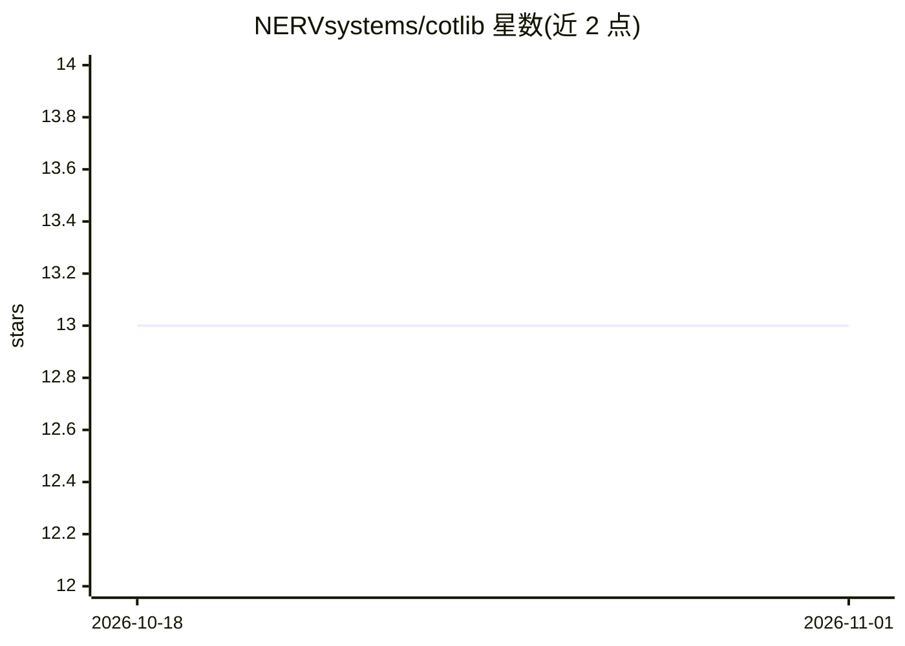

# NERVsystems/cotlib

⭐ 13 · Go · MIT · 推送 2026-10-05 · [GitHub](https://github.com/NERVsystems/cotlib) · 组织维护

**Go 语言 Cursor-on-Target (CoT) XML 消息解析/校验/生成库**

面向 TAK/ATK 互操作场景的 Go 库，提供 CoT 事件的创建、解析、XML 序列化与基于内嵌 XSD 的校验。内置 MITRE 规范与 TAK 扩展的完整类型目录，支持 GeoChat 消息与回执、how/relation 值校验、自定义类型注册，以及类型目录的分配无关搜索（LLM/AI 友好）。安全方面实现 XXE 防护、坐标与时间字段校验、可配置解析上限。Schema 校验依赖 libxml2 且构建需启用 CGO，这是使用该库的必要条件。

## 筛选速览

| 维度 | 判定 | 备注 |
|---|---|---|
| AI 角色 | `ai-enhanced` | 去掉 AI 部分产品仍成立 |
| 许可风险 | `permissive` | MIT |
| 部署形态 | `None` |  |
| 模型依赖 | — | README 未给出锁定关系 |
| 硬件要求 | — | 无带数字的原话,不猜 |
| 安装摩擦 | `low` | 无编译、无系统依赖或容器化 |
| 成熟度 | — | 结构信号不足 |

## 能力要点

- CoT 事件创建/解析/序列化，内嵌 XSD schema 校验
- MITRE 规范类型 + TAK/ 命名空间扩展类型目录，含 cotgen 生成器
- GeoChat 消息与回执支持，兼容 ATAK/WinTAK 客户端消息
- XXE 防护、字段校验、可配置解析上限等安全机制

## 适用场景

- 在 Go 服务中构建或解析 TAK 生态的 CoT XML 消息
- 对接 ATAK/WinTAK 客户端时校验 GeoChat 与 detail 扩展
- 按描述或全名检索 CoT 类型目录以接入 LLM/Agent 应用

## 场景标签

 · 领域:军事/地理空间互操作库

## 证据(README 行号)

> L9: A comprehensive Go library for creating, validating, and working with Cursor-on-Target (CoT) events.
> L36: **Note:** Schema validation relies on the `libxml2` library and requires CGO to be enabled when building.
> L29: - Type search by description or full name

## 星数曲线

2026-10-18 13 → 2026-11-01 13（+0）

---
*卡片 v1 · prompt 1.4 · 生成 2026-10-31 · 置信度 mid · 依据 README sha `059df5de8ce0` · [字段定义](../../DATASET.md)*
