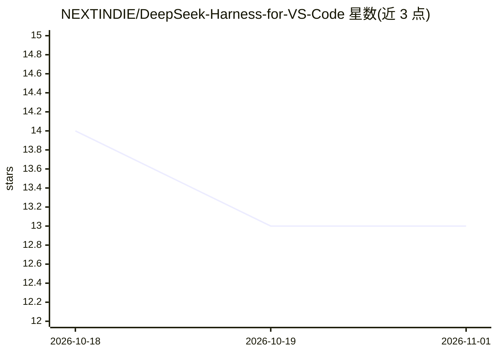

# NEXTINDIE/DeepSeek-Harness-for-VS-Code

⭐ 13 · JavaScript · NOASSERTION · 推送 2026-10-22 · [GitHub](https://github.com/NEXTINDIE/DeepSeek-Harness-for-VS-Code) · 个人维护 · 中文 README

**在 VS Code 中接入 DeepSeek Harness（dsh）的扩展客户端**

一个 VS Code 扩展，连接外部运行的 DeepSeek Harness（dsh）服务器（npx @deepseek-ai/dsh web 启动），在编辑器内提供 @dsh 聊天参与者、次级侧边栏与独立聊天窗口。功能包括流式回复与工具调用审批、逐步骤时间线、回合级 Git 回滚（通过 dsh-git-rollback 插件快照到隐藏 refs）、目标与计划模式、子代理、工作区/后台任务/自动化任务面板、13 种语言 UI，以及一键生成 Conventional Commits 提交信息。限制：需先在终端启动 dsh 服务器，扩展本身不独立运行。

## 筛选速览

| 维度 | 判定 | 备注 |
|---|---|---|
| AI 角色 | `ai-ecosystem` | LLM/agent 周边工具 |
| 许可风险 | `none` | NOASSERTION |
| 部署形态 | `library` | 以包/库形式分发 |
| 模型依赖 | locked-api |  |
| 硬件要求 | — | 无带数字的原话,不猜 |
| 安装摩擦 | `low` | 无编译、无系统依赖或容器化 |
| 成熟度 | — | 结构信号不足 |

## 能力要点

- @dsh 聊天参与者，流式回复、工具调用与审批按钮
- 回合级 Git 回滚：快照到隐藏 refs，支持 /rollback /redo /checkpoints
- 上下文用量环、75%/90% 告警与一键压缩上下文
- 工作区/后台任务/自动化任务/轨迹/设置多面板，13 种语言 UI

## 适用场景

- 在 VS Code 中直接驱动 dsh agent 完成编码任务
- 随时回滚 agent 某一轮造成的文件改动
- 在聊天中生成并填充 Conventional Commits 提交信息

## 场景标签

`编码 Agent` · 领域:编码与开发

## 证据(README 行号)

> L3: > **Before using this extension**: start the DeepSeek Harness server from your terminal first — the extension connec
> L11: Use DeepSeek Harness (`dsh`) directly in VS Code, alongside ChatGPT / Copilot: the built-in `@dsh` chat participant
> L17: - **Built-in chat participant `@dsh`**: type `@` in the native Chat panel (Ctrl+Alt+I); streamed replies with tool 

## 星数曲线

2026-10-18 14 → 2026-11-01 13（-1）

---
*卡片 v1 · prompt 1.4 · 生成 2026-10-31 · 置信度 mid · 依据 README sha `389df2ae81e6` · [字段定义](../../DATASET.md)*
