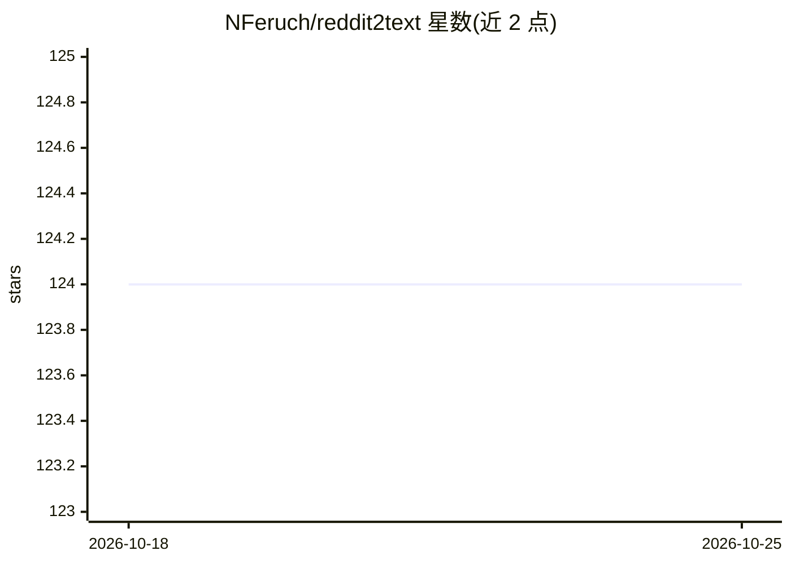

# NFeruch/reddit2text

⭐ 124 · Python · Apache-2.0 · 推送 2026-03-01 · [GitHub](https://github.com/NFeruch/reddit2text) · 个人维护

**把 Reddit 帖子及评论转为结构化文本的 Python 库**

基于 PRAW 封装的 Python 库：给定帖子链接与 Reddit 应用凭证（client_id/client_secret），读取帖子正文与全部评论，输出带层级缩进的纯文本，可配置最大评论深度与缩进分隔符。用途面向 LLM 提示词构造、NLP/数据分析与离线存档。功能以文本转换为主，文件保存、评论过滤、图片/视频支持等列入计划功能尚未实现。

## 筛选速览

| 维度 | 判定 | 备注 |
|---|---|---|
| AI 角色 | `ai-ecosystem` | LLM/agent 周边工具 |
| 许可风险 | `permissive` | Apache-2.0 |
| 部署形态 | `library` | 以包/库形式分发 |
| 模型依赖 | — | README 未给出锁定关系 |
| 硬件要求 | — | 无带数字的原话,不猜 |
| 安装摩擦 | `low` | 无编译、无系统依赖或容器化 |
| 成熟度 | — | 结构信号不足 |

## 能力要点

- 读取帖子与全量评论并输出层级缩进的结构化文本
- 可配置最大评论深度（max_comment_depth）与缩进分隔符（comment_delim）
- 通过环境变量或参数传入 Reddit API 凭证
- 以 pip 包形式提供，Apache 2.0 许可

## 适用场景

- 把 Reddit 讨论串转成文本喂给 LLM 做摘要或分析
- 对 Reddit 内容做 NLP 或数据分析的预处理
- 离线存档感兴趣的讨论帖

## 场景标签

`网页抓取` · 领域:效率与自动化

## 证据(README 行号)

> L5: Perfect for *prompting to an LLM, performing NLP/data analysis, or simply archiving for offline use*, `reddit2text` 
> L54: - Convert any Reddit thread (the post + all its comments) into structured text.

## 星数曲线

2026-10-18 124 → 2026-10-25 124（+0）

---
*卡片 v1 · prompt 1.4 · 生成 2026-10-23 · 置信度 mid · 依据 README sha `1d061745df8a` · [字段定义](../../DATASET.md)*
