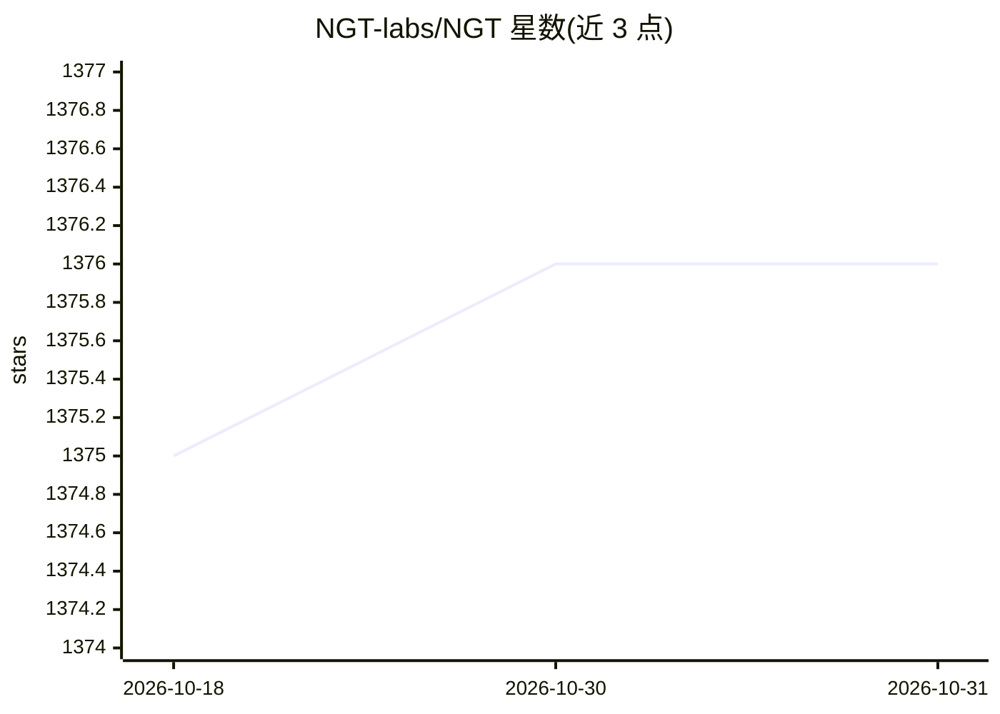

# NGT-labs/NGT

⭐ 1,376 · C++ · Apache-2.0 · 推送 2026-10-30 · [GitHub](https://github.com/NGT-labs/NGT) · 组织维护

**面向高维向量的近似最近邻搜索库与命令行工具**

提供图与树结构（NGT）、量化图（QG）与量化Blob图（QBG）三种索引方法，对数十到数千维向量空间的大规模数据执行高速近似最近邻搜索（ANN）。以 C/C++ 库与 ngt/qbg 命令行工具形式提供，绑定 Python、Ruby、PHP、Rust、Go 等语言，并可通过 ngtd 与 vald 作为分布式服务器使用。支持 L2、Cosine、Jaccard、内积等多种距离函数及 FP16、量化数据类型；QG/QBG 依赖 BLAS/LAPACK，Windows 仅支持 MinGW-w64（MSVC 暂不支持）。

## 筛选速览

| 维度 | 判定 | 备注 |
|---|---|---|
| AI 角色 | `ai-ecosystem` | LLM/agent 周边工具 |
| 许可风险 | `permissive` | Apache-2.0 |
| 部署形态 | `library` | 以包/库形式分发 |
| 模型依赖 | — | README 未给出锁定关系 |
| 硬件要求 | — | 无带数字的原话,不猜 |
| 安装摩擦 | `medium` | 含编译或系统依赖之一 |
| 成熟度 | — | 结构信号不足 |

## 能力要点

- NGT/QG/QBG 三种索引方法，QBG 可处理十亿级对象
- 支持 L1/L2/Cosine/Hamming/Jaccard/Poincare/Lorentz/内积等距离函数
- Python/Ruby/PHP/Rust/Go/C/C++ 多语言绑定，ngtd 与 vald 分布式服务器
- 共享内存（mmap）选项处理超内存规模索引

## 适用场景

- 为相似向量检索系统构建高维 ANN 索引
- 在向量检索服务（如 vald）底层提供索引能力
- 用 ngt/qbg 命令行对大规模向量数据做近邻搜索实验

## 场景标签

`向量数据库` · 领域:知识与检索

## 证据(README 行号)

> L7: **NGT** provides commands and a library for performing high-speed approximate nearest neighbor searches against a la
> L119: - Supported languages: Python, Ruby, PHP, Rust, Go, C, and C++
> L129: - Server : ngtd and vald

## 星数曲线

2026-10-18 1,375 → 2026-10-31 1,376（+1）

---
*卡片 v1 · prompt 1.4 · 生成 2026-10-21 · 置信度 high · 依据 README sha `2ffa558e2418` · [字段定义](../../DATASET.md)*
