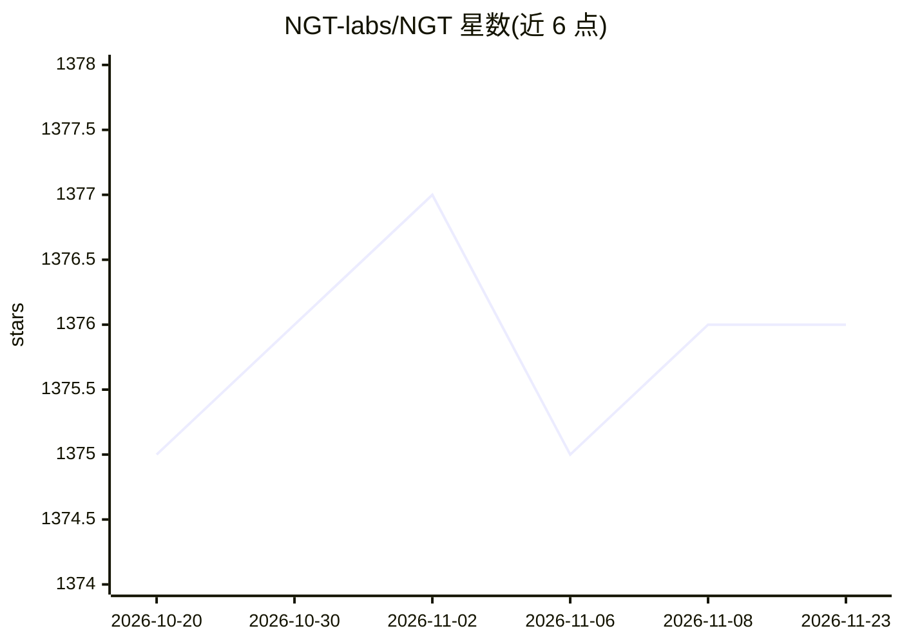

# NGT-labs/NGT

⭐ 1,376 · C++ · Apache-2.0 · 推送 2026-11-20 · [GitHub](https://github.com/NGT-labs/NGT) · 组织维护

**高维向量近似最近邻搜索的图+树索引库**

NGT 提供命令行工具与库，对高维向量数据（数十至数千维）执行近似最近邻搜索。包含三种方法：基础图+树索引 NGT、量化图 QG、可处理数十亿对象的 QBG；支持 L2、Cosine、内积、Jaccard 等多种距离函数与共享内存、大规模数据集构建参数。以源码编译安装为主，macOS 提供 Homebrew 预编译包，Python 可从 PyPI 安装，另有 Python/Ruby/PHP/Rust/Go/C/C++ 等语言绑定及 ngtd、vald 分布式服务。

## 筛选速览

| 维度 | 判定 | 备注 |
|---|---|---|
| AI 角色 | `ai-native` | 本体是模型或模型工具 |
| 许可风险 | `permissive` | Apache-2.0 |
| 部署形态 | `library` | 以包/库形式分发 |
| 模型依赖 | — | README 未给出锁定关系 |
| 硬件要求 | — | 无带数字的原话,不猜 |
| 安装摩擦 | `medium` | 含编译或系统依赖之一 |
| 成熟度 | — | 结构信号不足 |

## 能力要点

- 三种索引方法：NGT（图+树）、QG（量化图）、QBG（可处理数十亿对象）
- 支持 L1/L2/Cosine/Angular/Hamming/Jaccard/Poincare/Lorentz/内积等距离函数
- 共享内存选项支持超出内存规模的索引与多进程复用
- 多语言绑定与 ngtd/vald 分布式服务

## 适用场景

- 为图像搜索或词向量检索构建近似最近邻索引
- 在数十亿级向量上做量化图检索
- 通过 Python 包在 LlamaIndex 中作为向量存储使用

## 场景标签

`向量数据库` · 领域:知识与检索

## 证据(README 行号)

> L7: **NGT** provides commands and a library for performing high-speed approximate nearest neighbor searches against a la
> L27: - NGT: Graph and tree-based method

## 星数曲线

2026-10-20 1,375 → 2026-11-23 1,376（+1）

---
*卡片 v1 · prompt 1.4 · 生成 2026-11-23 · 置信度 high · 依据 README sha `4ff7a0218df4` · [字段定义](../../DATASET.md)*
