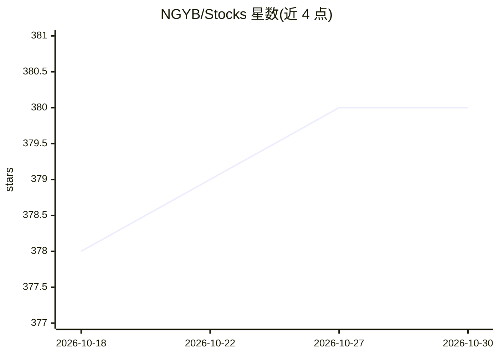

# NGYB/Stocks

⭐ 380 · Jupyter Notebook · Apache-2.0 · 推送 2026-07-10 · [GitHub](https://github.com/NGYB/Stocks) · 个人维护

**股票预测与评估程序集合**

自述为用于股票预测与评估的程序集合，主题标签涉及机器学习、信号处理、预测模型与股市交易。README 仅有一行描述与 Star History，未说明具体模型、算法、输入数据格式或运行方式，也无安装与使用说明。依据仓库主题标签推断面向股市预测开发者，属机器学习预测类代码集合，具体功能与限制需查阅代码确认。

## 筛选速览

| 维度 | 判定 | 备注 |
|---|---|---|
| AI 角色 | `ai-native` | 本体是模型或模型工具 |
| 许可风险 | `permissive` | Apache-2.0 |
| 部署形态 | `None` |  |
| 模型依赖 | — | README 未给出锁定关系 |
| 硬件要求 | — | 无带数字的原话,不猜 |
| 安装摩擦 | `low` | 无编译、无系统依赖或容器化 |
| 成熟度 | — | 结构信号不足 |

## 能力要点

- 股票预测相关程序
- 包含预测结果评估功能
- 主题标签涵盖机器学习与信号处理

## 适用场景

- 参考机器学习方法做股价预测实验
- 对股票预测结果进行评估

## 场景标签

`金融量化` · 领域:学习与行业

## 证据(README 行号)

> L2: Programs for stock prediction and evaluation

## 星数曲线

2026-10-18 378 → 2026-10-30 380（+2）

---
*卡片 v1 · prompt 1.4 · 生成 2026-10-21 · 置信度 low · 依据 README sha `c2b8fedd0cbf` · [字段定义](../../DATASET.md)*
