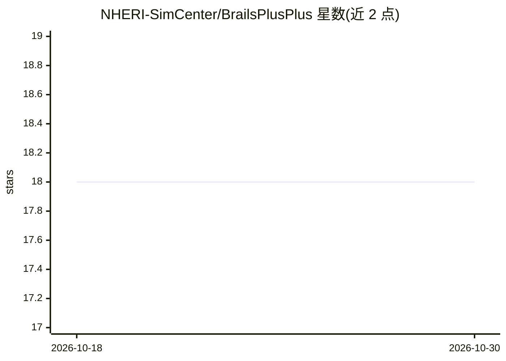

# NHERI-SimCenter/BrailsPlusPlus

⭐ 18 · Python · NOASSERTION · 推送 2026-10-12 · [GitHub](https://github.com/NHERI-SimCenter/BrailsPlusPlus) · [官网](https://simcenter.designsafe-ci.org/backend-components/brails/) · 组织维护

**生成大范围地理区域建筑资产清单的面向对象框架**

面向自然灾害区域仿真的 Python 框架，提供模块化工作流，通过整合公开数据集、影像提取特征与基于规则集的推断模型，生成大地理区域的建筑资产清单（inventory）。以面向对象方式组织各模块，供构建区域级仿真应用的开发者使用。可通过 pip 安装 brails 包，或从 GitHub 源码安装；可见 README 未展开更多依赖或运行细节。

## 筛选速览

| 维度 | 判定 | 备注 |
|---|---|---|
| AI 角色 | `ai-native` | 本体是模型或模型工具 |
| 许可风险 | `none` | NOASSERTION |
| 部署形态 | `library` | 以包/库形式分发 |
| 模型依赖 | — | README 未给出锁定关系 |
| 硬件要求 | — | 无带数字的原话,不猜 |
| 安装摩擦 | `low` | 无编译、无系统依赖或容器化 |
| 成熟度 | — | 结构信号不足 |

## 能力要点

- 面向对象框架，用于构建生成区域资产清单的应用
- 整合公开数据集、影像特征提取与规则集推断模型
- 支持 pip 与 GitHub 源码两种安装方式

## 适用场景

- 为区域自然灾害仿真生成建筑资产清单
- 整合多源数据构建大地理区域的建筑数据库

## 场景标签

`目标检测` · 领域:感知与多模态

## 证据(README 行号)

> L10: ```BRAILS++``` is an object-oriented framework for building applications that focus on generating asset inventories
> L12:  BRAILS++ provides modular workflows for generating inventories by integrating diverse data sources, including publ

## 星数曲线



2026-10-18 18 → 2026-10-30 18（+0）


---
*卡片 v1 · prompt 1.4 · 生成 2026-10-29 · 置信度 mid · 依据 README sha `24cba00b6373` · [字段定义](../../DATASET.md)*
