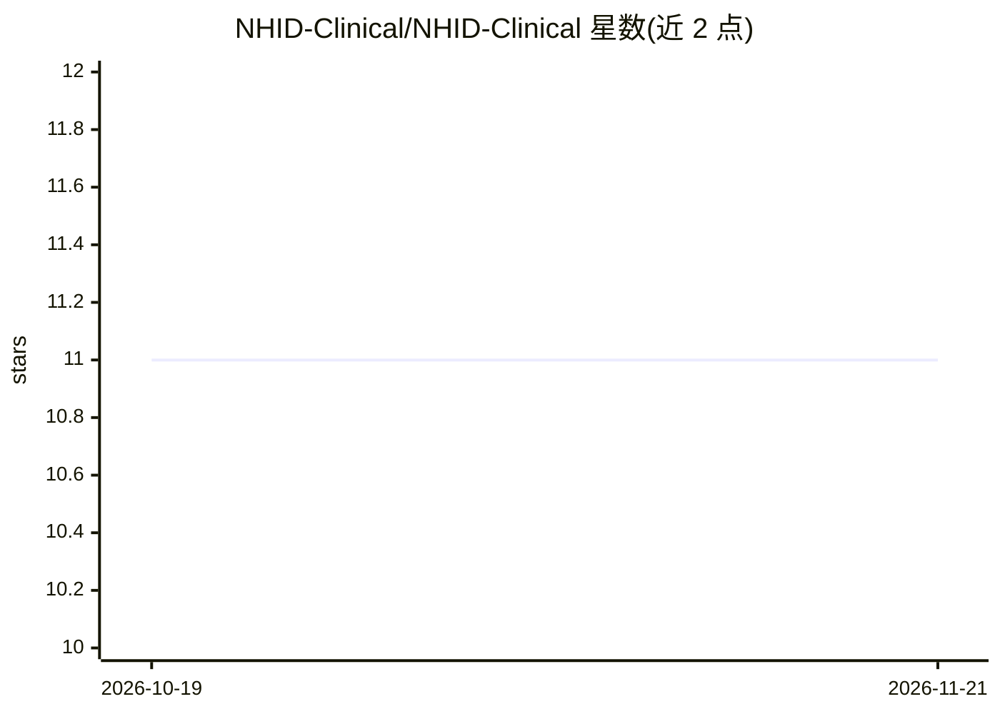

# NHID-Clinical/NHID-Clinical

⭐ 11 · Python · Apache-2.0 · 推送 2026-11-18 · [GitHub](https://github.com/NHID-Clinical/NHID-Clinical) · [官网](https://nhid-clinical.org/) · 组织维护

**医疗语音 AI 代理合规评测框架：检查来电代理是否先亮明 AI 身份**

面向呼叫医保支付方的 AI 语音代理的开源规范与确定性参考实现：在每次对话轮次上评估五项控制（身份披露门、数据交换前置门、欺骗行为检查、转人工执行、审计留痕），输出机器可读的治理证据与违规记录。全部离线运行、不做网络调用，不做语音识别，仅评估转写文本；明确声明非标准、非认证、未经验证，处于研究阶段。提供 pip 安装、托管演示 API 与 shadow pilot 工具包。

## 筛选速览

| 维度 | 判定 | 备注 |
|---|---|---|
| AI 角色 | `ai-ecosystem` | LLM/agent 周边工具 |
| 许可风险 | `permissive` | Apache-2.0 |
| 部署形态 | `library` | 以包/库形式分发 |
| 模型依赖 | — | README 未给出锁定关系 |
| 硬件要求 | — | 无带数字的原话,不猜 |
| 安装摩擦 | `low` | 无编译、无系统依赖或容器化 |
| 成熟度 | `idea` | |

## 能力要点

- 五项可测试控制逐轮独立评估，取最严苛结果（DENY_DATA 至 CONTINUE_AI 优先级）
- Shadow Pilot Kit 在本地离线测量来电日志的冒充延迟与披露率
- 证据导出为 FHIR R4 AuditEvent 样例，供厂商提交审查
- NHID-Auth v2 委托授权层与每调用作用域签名证明

## 适用场景

- 支付方在接收侧对既有通话记录做 observe-only 影子评估
- 语音 AI 厂商为自己的通话路径产出合规证据包
- 开发者本地运行策略引擎或调用托管 API 检查单轮对话

## 场景标签

`模型评测` · 领域:评测与运维

## 证据(README 行号)

> L3: **What it is:** an independent research project and open reference implementation for AI agents that call healthcare
> L50: An AI voice agent phones a payer, says it is calling for a provider, and asks for a patient's eligibility, claim st
> L131: - Deterministic policy engine and the conformance test suite; every published figure is measured from `src/nhid_po

## 星数曲线

2026-10-19 11 → 2026-11-21 11（+0）

---
*卡片 v1 · prompt 1.4 · 生成 2026-11-19 · 置信度 high · 依据 README sha `cf1aa6106ee1` · [字段定义](../../DATASET.md)*
