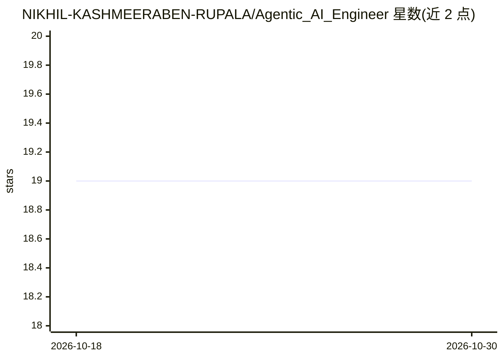

# NIKHIL-KASHMEERABEN-RUPALA/Agentic_AI_Engineer

⭐ 19 · Jupyter Notebook · MIT · 推送 2026-09-27 · [GitHub](https://github.com/NIKHIL-KASHMEERABEN-RUPALA/Agentic_AI_Engineer) · 个人维护

**个人 Agentic AI 工程师学习与实践项目集合**

个人学习仓库，记录作者通过结构化学习、项目与实验成为 Agentic AI 工程师的过程，内容涉及多智能体系统、A2A 协议、MCP、LangChain/LangGraph、智能体编排、LLM 评测与护栏、FastAPI 与 Kubernetes 部署等主题。README 仅含标题与一句自我介绍，未展示具体安装或运行说明；仓库以主题标签形式描述覆盖范围，供同类学习者参考浏览。

## 筛选速览

| 维度 | 判定 | 备注 |
|---|---|---|
| AI 角色 | `ai-knowledge` | 知识聚合/清单类 |
| 许可风险 | `permissive` | MIT |
| 部署形态 | `None` |  |
| 模型依赖 | — | README 未给出锁定关系 |
| 硬件要求 | — | 无带数字的原话,不猜 |
| 安装摩擦 | `low` | 无编译、无系统依赖或容器化 |
| 成熟度 | — | 结构信号不足 |

## 能力要点

- 记录结构化学习路径与项目实验
- 主题覆盖多智能体系统、A2A/MCP 协议与 LLM 评测
- 包含 FastAPI 与 Kubernetes 部署相关实践

## 适用场景

- 了解 Agentic AI 工程师的学习路径与项目结构
- 查找多智能体与 LLM 工具链相关的实践示例

## 场景标签

`Agent 框架` `多智能体` · 领域:Agent 开发

## 证据(README 行号)

> L2: My complete journey to becoming an Agentic AI Engineer through structured learning, projects, experiments, and produ

## 星数曲线

2026-10-18 19 → 2026-10-30 19（+0）

---
*卡片 v1 · prompt 1.4 · 生成 2026-10-29 · 置信度 low · 依据 README sha `c38d04b6c252` · [字段定义](../../DATASET.md)*
