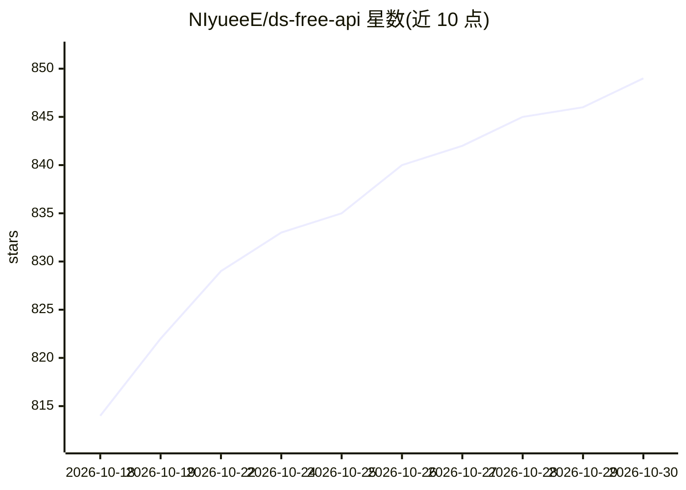

# NIyueeE/ds-free-api

⭐ 849 · Rust · GPL-3.0 · 推送 2026-10-08 · [GitHub](https://github.com/NIyueeE/ds-free-api) · 个人维护 · 中文 README

**把 DeepSeek 免费网页端反代为 OpenAI/Anthropic 兼容 API 的 Rust 代理**

Rust 实现的单二进制 API 代理服务：将 DeepSeek 网页端对话反代并转换为 OpenAI Chat Completions、OpenAI Responses 与 Anthropic Messages 三种兼容协议，支持流式、工具调用（含三层自修复解析）、文件上传与幂等重试。面向希望用标准 API 客户端调用 DeepSeek 网页端的开发者。内置多账号池轮转、风控令牌处理（x-hif-leim、device_id）与 Web 管理面板。限制：上游风控持续收紧，公共测试账号已失效，需自备账号与浏览器指纹；上游已下线 expert/vision 模式，目前仅暴露 deepseek-default。

## 筛选速览

| 维度 | 判定 | 备注 |
|---|---|---|
| AI 角色 | `ai-ecosystem` | LLM/agent 周边工具 |
| 许可风险 | `viral` | GPL-3.0 |
| 部署形态 | `self-host` | docker 或自建部署 |
| 模型依赖 | locked-api |  |
| 硬件要求 | — | 无带数字的原话,不猜 |
| 安装摩擦 | `low` | 无编译、无系统依赖或容器化 |
| 成熟度 | — | 结构信号不足 |

## 能力要点

- 同时兼容 OpenAI Chat Completions / Responses 与 Anthropic Messages 三协议
- 工具调用三层自修复管道（文本修复→JSON修复→模型兜底）
- 多账号池空闲最久优先轮转 + 幂等重试（Idempotency-Key 字节级回放）
- 内置 Web 管理面板（账号池、API Key、日志、三语 i18n、PWA）

## 适用场景

- 让 Claude Code / Codex 等标准 API 客户端直接调用 DeepSeek 网页端
- 用 OpenAI/Anthropic 格式客户端零成本访问 DeepSeek 对话能力
- 多账号轮转搭建自用的 DeepSeek 兼容 API 服务

## 场景标签

 · 领域:LLM 基础设施/API 代理

## 证据(README 行号)

> L5: 将免费的 DeepSeek 网页端对话反代并适配转换为标准的 OpenAI 与 Anthropic 兼容 API 协议（目前支持 chat completions 和 messages，包括流式返回与工具调用）。
> L12: - **三协议支持**：同时兼容 OpenAI Chat Completions、OpenAI Responses（`/v1/responses` + `GET /v1/responses/{id}` 检索）与 Anthropic

## 星数曲线

2026-10-18 814 → 2026-10-30 849（+35）

---
*卡片 v1 · prompt 1.4 · 生成 2026-10-21 · 置信度 high · 依据 README sha `9dde0fee75be` · [字段定义](../../DATASET.md)*
