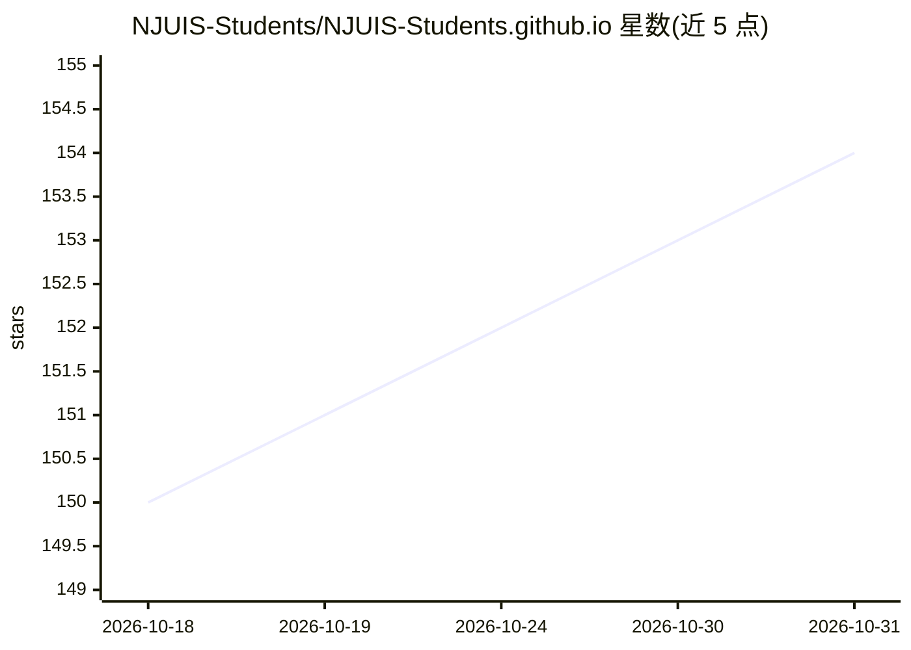

# NJUIS-Students/NJUIS-Students.github.io

⭐ 154 · 推送 2026-10-29 · [GitHub](https://github.com/NJUIS-Students/NJUIS-Students.github.io) · [官网](https://njuis-students.github.io/) · 组织维护 · 中文 README

**南大智能学院学生的课程资料与经验民间 Wiki 站点**

基于 VitePress 搭建的静态文档站点，面向南京大学智能科学与技术学院学生：聚合课程资料、学习路线、学习经验与课程总结文章，通过 PR 协作共建与持续更新。仓库内容存放于 docs/ 目录，本地经 npm install 与 npm run docs:dev 启动开发服务器预览，另关联独立的资源仓库 Resources。该仓库本身不提供 AI 模型或算法内容。

## 筛选速览

| 维度 | 判定 | 备注 |
|---|---|---|
| AI 角色 | `ai-knowledge` | 知识聚合/清单类 |
| 许可风险 | `none` | — |
| 部署形态 | `library` | 以包/库形式分发 |
| 模型依赖 | — | README 未给出锁定关系 |
| 硬件要求 | — | 无带数字的原话,不猜 |
| 安装摩擦 | `low` | 无编译、无系统依赖或容器化 |
| 成熟度 | — | 结构信号不足 |

## 能力要点

- 聚合历届学生的课程资料与学习路线文章
- 任何学生可通过 PR 增补内容与纠错
- 基于 VitePress 构建与本地开发预览

## 适用场景

- 查找南大智能学院课程资料与前辈经验
- 新生了解专业学习路线与方向入门
- 学生通过 PR 共建和更新课程攻略

## 场景标签

`教程课程` · 领域:学习与行业

## 证据(README 行号)

> L13: > 一个面向南京大学智能科学与技术学院的民间 Wiki，聚合课程资料、学习路线与经验文章，帮助后来者少走弯路。
> L25: - `资源沉淀`：把历届同学零散资料变成可检索、可维护的知识库。

## 星数曲线

2026-10-18 150 → 2026-10-31 154（+4）

---
*卡片 v1 · prompt 1.4 · 生成 2026-10-22 · 置信度 mid · 依据 README sha `c575cf776259` · [字段定义](../../DATASET.md)*
