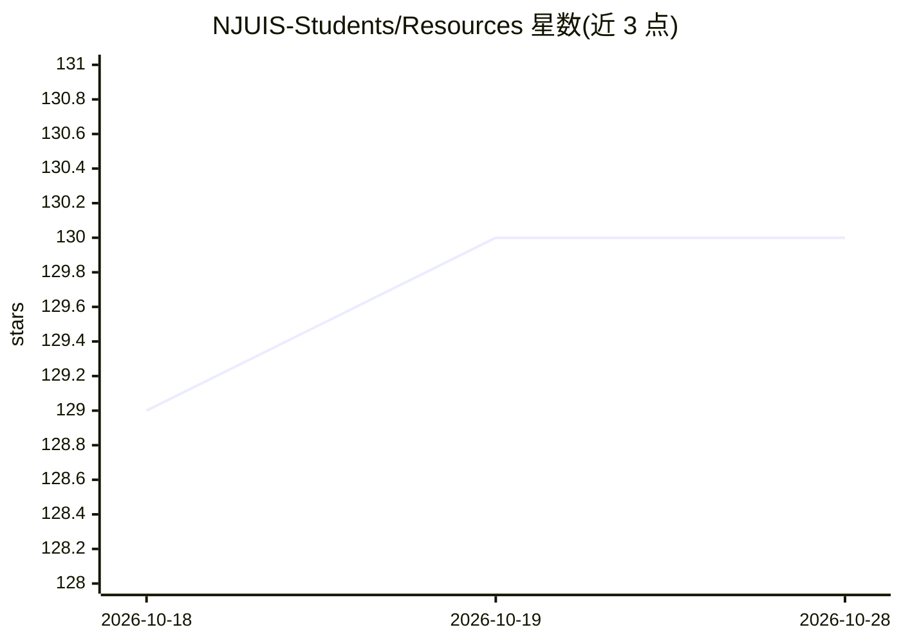

# NJUIS-Students/Resources

⭐ 130 · HTML · GPL-3.0 · 推送 2026-09-02 · [GitHub](https://github.com/NJUIS-Students/Resources) · [官网](https://njuis-students.github.io/) · 组织维护 · 中文 README

**南京大学智能学院课程资料库：课件、试卷与笔记**

由南京大学智能科学与技术学院学生组织维护的课程资料仓库，收录历年课程的课件、作业、往年试卷（期中/期末，区分带答案、无答案、回忆版）与笔记，按课程名称/开课时间/授课老师/章节的目录结构组织，部分目录附 Readme.md 说明。上传资料需先获得授课老师同意；GitHub 访问受限时提供镜像站。本身不含代码，不提供安装运行方式。

## 筛选速览

| 维度 | 判定 | 备注 |
|---|---|---|
| AI 角色 | `ai-knowledge` | 知识聚合/清单类 |
| 许可风险 | `viral` | GPL-3.0 |
| 部署形态 | `None` |  |
| 模型依赖 | — | README 未给出锁定关系 |
| 硬件要求 | — | 无带数字的原话,不猜 |
| 安装摩擦 | `low` | 无编译、无系统依赖或容器化 |
| 成熟度 | — | 结构信号不足 |

## 能力要点

- 收录历年课件、作业、往年试卷与笔记
- 按课程/学期/授课老师/章节的目录规范组织
- 试卷区分期中/期末与带答案、无答案、回忆版

## 适用场景

- 备考时查找往年试卷与答案版本
- 课后对照课件与笔记复习
- 了解智能科学与技术学院课程安排

## 场景标签

`精选清单` · 领域:学习与行业

## 证据(README 行号)

> L1: # 南京大学智能科学与技术学院课程资料仓库
> L3: 本仓库包含南京大学智能科学与技术学院历年课程的课件、试卷与笔记，请访问项目网站获取更多信息。
> L13: * 课件和作业：课程名称/开课时间/授课老师/(课件、作业)/两位数字-章节名称

## 星数曲线

2026-10-18 129 → 2026-10-28 130（+1）

---
*卡片 v1 · prompt 1.4 · 生成 2026-10-22 · 置信度 high · 依据 README sha `88e7e8ea21d2` · [字段定义](../../DATASET.md)*
