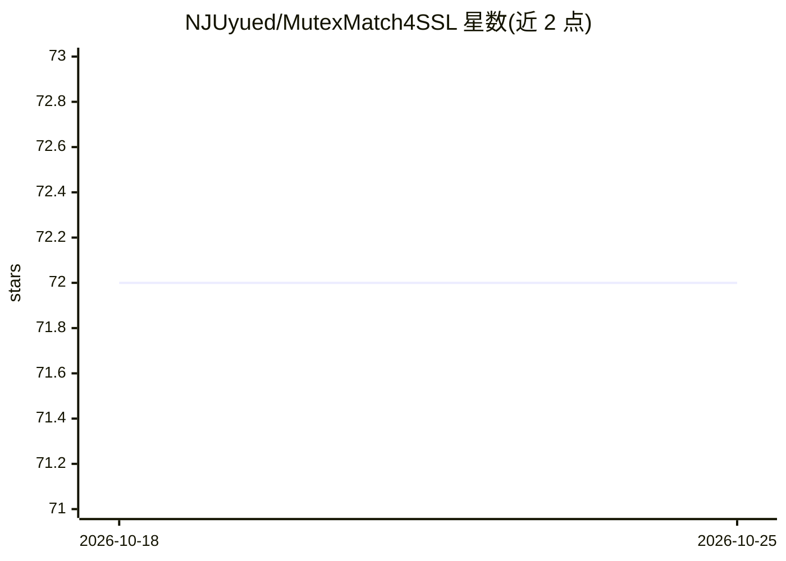

# NJUyued/MutexMatch4SSL

⭐ 72 · Python · MIT · 推送 2025-11-20 · [GitHub](https://github.com/NJUyued/MutexMatch4SSL) · 组织维护 · 中文 README

**半监督学习论文官方 PyTorch 实现，低置信样本互斥一致性训练**

TNNLS 2024 论文 MutexMatch 的官方 PyTorch 代码：通过基于互斥的一致性正则化利用低置信度无标注样本——高置信样本由真阳性分类器（TPC）预测"是什么"，低置信样本由真阴性分类器（TNC）预测"不是什么"，以缓解伪标签错误。支持 CIFAR-10/100、SVHN、STL-10、mini/tiny-ImageNet 六个数据集，WRN/ResNet-18/CNN-13 三种骨干，单卡与多卡（DataParallel/DistributedDataParallel）训练，附各配置预训练权重与复现结果表。代码基于 FixMatch-pytorch 修改，依赖 torch 1.4.0+cu92。

## 筛选速览

| 维度 | 判定 | 备注 |
|---|---|---|
| AI 角色 | `ai-native` | 本体是模型或模型工具 |
| 许可风险 | `permissive` | MIT |
| 部署形态 | `None` |  |
| 模型依赖 | — | README 未给出锁定关系 |
| 硬件要求 | — | 无带数字的原话,不猜 |
| 安装摩擦 | `low` | 无编译、无系统依赖或容器化 |
| 成熟度 | — | 结构信号不足 |

## 能力要点

- TPC/TNC 双分类器的互斥一致性正则化，利用低置信样本
- 支持 CIFAR-10/100、SVHN、STL-10、mini/tiny-ImageNet 六数据集
- WRN-28-2/8、ResNet-18、CNN-13 三种骨干网络可选
- 提供单卡/多卡训练、断点续训、评估脚本及预训练权重

## 适用场景

- 复现论文中各标签量下的半监督分类精度
- 在自己数据集上跑低标注量的图像分类训练
- 在 FixMatch 基础上扩展互斥一致性方法做对比实验

## 场景标签

 · 领域:机器学习/半监督图像分类

## 证据(README 行号)

> L3: This repo is the official Pytorch implementation of our paper:
> L34: **The core issue in semi-supervised learning (SSL) lies in how to effectively leverage unlabeled data, whereas most

## 星数曲线

2026-10-18 72 → 2026-10-25 72（+0）

---
*卡片 v1 · prompt 1.4 · 生成 2026-10-24 · 置信度 high · 依据 README sha `fc92dc55c375` · [字段定义](../../DATASET.md)*
