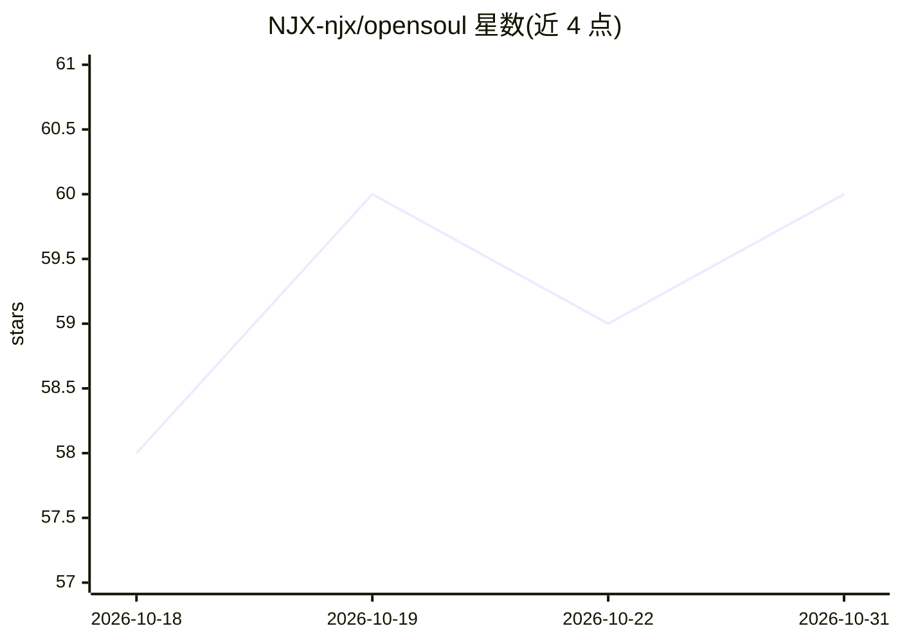

# NJX-njx/opensoul

⭐ 60 · TypeScript · MIT · 推送 2026-06-04 · [GitHub](https://github.com/NJX-njx/opensoul) · [官网](https://opensoul-web.vercel.app/) · 个人维护

**自托管跨渠道 AI agent 运行时，支持任务跨界面延续**

用 TypeScript/Node.js 编写的自托管 AI agent 运行时（基于 OpenClaw）：同一 agent 可在 WhatsApp、Telegram、Discord、Slack 等 30+ 消息渠道或 Web Control UI 中启动任务，并随工作转移到 Canvas、cron、子 agent 与后续会话中延续执行。本地优先的控制平面整合渠道适配器、任务延续状态、模型路由、记忆与工具。支持 OpenAI/Anthropic/OpenRouter/Gemini/MiniMax 等模型 key 配置，提供 npm 全局安装与源码构建两种方式，MIT 许可。

## 筛选速览

| 维度 | 判定 | 备注 |
|---|---|---|
| AI 角色 | `ai-ecosystem` | LLM/agent 周边工具 |
| 许可风险 | `permissive` | MIT |
| 部署形态 | `library` | 以包/库形式分发 |
| 模型依赖 | — | README 未给出锁定关系 |
| 硬件要求 | — | 无带数字的原话,不猜 |
| 安装摩擦 | `low` | 无编译、无系统依赖或容器化 |
| 成熟度 | — | 结构信号不足 |

## 能力要点

- 跨界面任务延续：tasks、承诺、事件时间线与交接轨迹在 Control UI 右栏可见
- 支持 WhatsApp/Telegram/Discord/Slack 等多渠道接入与插件扩展（plugin-sdk）
- 多模型路由与长期记忆，网关需 token 启动
- 提供 CLI（opensoul onboard）与 npm 全局安装，也支持 pnpm 源码构建

## 适用场景

- 在常用聊天软件里与自托管 AI 伴侣对话并延续任务
- 从 DM 开始的任务无缝交接到浏览器 Canvas 与定时任务继续执行
- 通过插件 SDK 扩展自定义渠道与工具

## 场景标签

`聊天机器人` `多智能体` `Agent 框架` · 领域:Agent 开发

## 证据(README 行号)

> L4:  Self-hosted AI agent runtime for cross-surface task continuity across chat apps, Control UI, Canvas, cron, and pair
> L26: It is a **local-first control plane**: channel adapters, task continuity state, model routing, memory, tools, and s

## 星数曲线

2026-10-18 58 → 2026-10-31 60（+2）

---
*卡片 v1 · prompt 1.4 · 生成 2026-10-24 · 置信度 high · 依据 README sha `85d6c6538d71` · [字段定义](../../DATASET.md)*
