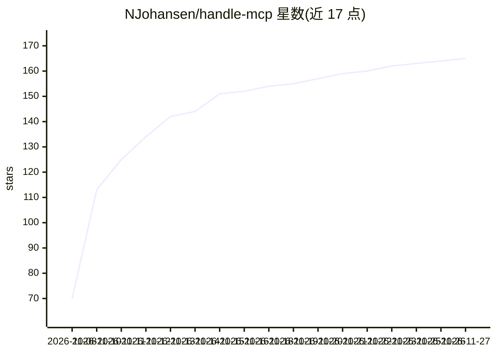

# NJohansen/handle-mcp

⭐ 165 · Python · MIT · 推送 2026-11-26 · [GitHub](https://github.com/NJohansen/handle-mcp) · [官网](https://handlemcp.dk) · 个人维护

**让 AI agent 在丹麦三家超市比价并填充购物车的 MCP server**

面向 nemlig.com、BilkaToGo 与 REMA 1000 三家丹麦超市的 MCP server，接入 Claude、Grok、Codex 等 MCP 客户端。提供 13 个工具：读取本周特价与菜谱、按预算规划一周餐食、在全部门店比价（含包装规格、运费与起送门槛）、填充最低价门店的购物车。设计上仅写购物车，不具备下单或支付能力（有测试保障），用户自行到门店核对并付款。遥测默认关闭，需用户显式同意。

## 筛选速览

| 维度 | 判定 | 备注 |
|---|---|---|
| AI 角色 | `ai-ecosystem` | LLM/agent 周边工具 |
| 许可风险 | `permissive` | MIT |
| 部署形态 | `library` | 以包/库形式分发 |
| 模型依赖 | — | README 未给出锁定关系 |
| 硬件要求 | — | 无带数字的原话,不猜 |
| 安装摩擦 | `low` | 无编译、无系统依赖或容器化 |
| 成熟度 | — | 结构信号不足 |

## 能力要点

- 13 个 MCP 工具：商品/菜谱搜索、特价读取、营养查询、跨店比价、购物车填充
- compare_basket 按含运费的总额在三家门店排序
- 仅写购物车，代码中不存在下单/支付路径并有测试校验
- 匿名遥测默认关闭，可用 CLI/环境变量控制

## 适用场景

- 给 AI agent 设定月度食品预算，让它按特价规划一周餐食
- 同一份购物清单在三家丹麦超市间比价
- 把菜谱食材一键加入最低价门店的购物车
- 查询明日最便宜的配送时段

## 场景标签

 · 领域:生活服务/购物工具

## 证据(README 行号)

> L13: **Let your AI agent shop at nemlig.com, BilkaToGo and REMA 1000.**
> L14: An MCP server for Claude, Grok or Codex. It reads the offers, plans the week on your budget and fills the cheapest 
> L37: - An MCP client, Grok, Claude Code, Claude Desktop or Codex etc.

## 星数曲线

2026-11-08 70 → 2026-11-27 165（+95）

---
*卡片 v1 · prompt 1.4 · 生成 2026-11-27 · 置信度 high · 依据 README sha `0b72e8d0e087` · [字段定义](../../DATASET.md)*
