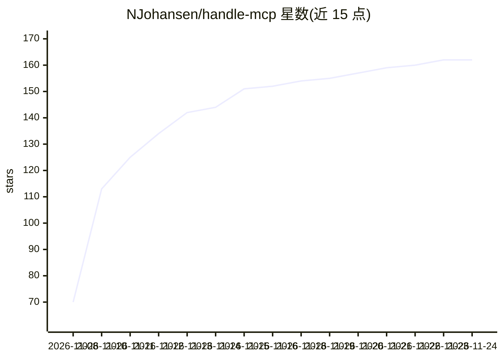

# NJohansen/handle-mcp

⭐ 162 · Python · MIT · 推送 2026-11-22 · [GitHub](https://github.com/NJohansen/handle-mcp) · [官网](https://handlemcp.dk) · 个人维护

**让 AI 代理在丹麦三家超市比价并填购物车的 MCP server**

面向 Claude、Grok、Codex 等 MCP 客户端的 Python MCP server，接入 nemlig.com、BilkaToGo、REMA 1000 三家丹麦超市的私有网站 API。提供商品搜索、食谱、本周优惠、营养信息、跨店购物篮比价（含包装规格、配送费、起送额）及填写购物车等 12 个工具；设计上不含下单/支付代码，付款由用户完成。通过 uvx 安装，要求 macOS/Linux/Windows x64（Windows ARM 不支持）、uv 和对应超市账户；非官方，依赖私有 API，可能随时失效；默认关闭匿名用量统计，开启与否由用户选择。

## 筛选速览

| 维度 | 判定 | 备注 |
|---|---|---|
| AI 角色 | `ai-ecosystem` | LLM/agent 周边工具 |
| 许可风险 | `permissive` | MIT |
| 部署形态 | `library` | 以包/库形式分发 |
| 模型依赖 | — | README 未给出锁定关系 |
| 硬件要求 | — | 无带数字的原话,不猜 |
| 安装摩擦 | `low` | 无编译、无系统依赖或容器化 |
| 成熟度 | — | 结构信号不足 |

## 能力要点

- 12 个 MCP 工具：搜索、食谱、优惠、营养、跨店比价、填购物车、配送时段查询
- 跨店整单比价（包装规格、优惠、配送费、最小订单额）后填最便宜的一家的购物车
- 不含下单/支付代码，有测试防止该代码出现
- 匿名用量统计默认关闭，可用命令/环境变量开关

## 适用场景

- 让 AI 代理按周预算基于超市优惠规划一周餐食
- 把整份购物清单在三家丹麦超市比价并自动填入最便宜的购物车
- 查询本周优惠、免费赠品和最便宜的配送/自提时段

## 场景标签

`网页抓取` · 领域:效率与自动化

## 证据(README 行号)

> L14: An MCP server for Claude, Grok or Codex. It reads the offers, plans the week on your budget and fills the cheapest 
> L37: - An MCP client, Grok, Claude Code, Claude Desktop or Codex etc.

## 星数曲线

2026-11-08 70 → 2026-11-24 162（+92）

---
*卡片 v1 · prompt 1.4 · 生成 2026-11-17 · 置信度 high · 依据 README sha `4b789158d6ed` · [字段定义](../../DATASET.md)*
