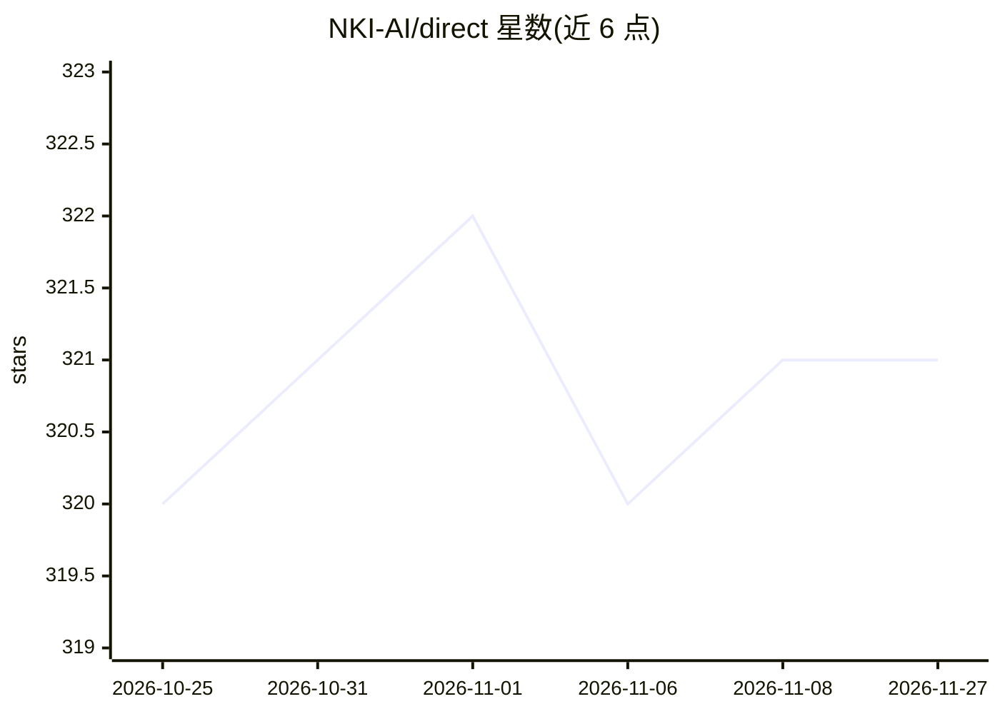

# NKI-AI/direct

⭐ 321 · Python · Apache-2.0 · 推送 2026-11-11 · [GitHub](https://github.com/NKI-AI/direct) · [官网](https://docs.aiforoncology.nl/direct) · 组织维护

**面向科研人员的加速 MRI 重建 PyTorch 工具包**

DIRECT 是处理欠采样多线圈 k-space 的端到端工具链，覆盖采样掩码、线圈灵敏度估计、多种重建模型、可选配准、MRI 指标与预训练基线。内置 vSHARP、RecurrentVarNet、RIM 等挑战赛获奖模型，支持全监督、SSDU、JSSL 训练范式与分布式多 GPU、混合精度训练。通过 ``direct train`` / ``direct predict`` CLI 使用，预训练权重托管在 Hugging Face。README 声明不用于临床用途。

## 筛选速览

| 维度 | 判定 | 备注 |
|---|---|---|
| AI 角色 | `ai-native` | 本体是模型或模型工具 |
| 许可风险 | `permissive` | Apache-2.0 |
| 部署形态 | `library` | 以包/库形式分发 |
| 模型依赖 | — | README 未给出锁定关系 |
| 硬件要求 | — | 无带数字的原话,不猜 |
| 安装摩擦 | `low` | 无编译、无系统依赖或容器化 |
| 成熟度 | — | 结构信号不足 |

## 能力要点

- 包含 15+ 种重建模型（vSHARP、RecurrentVarNet、RIM/CIRIM、U-Net、ViT 等）
- 内置 Cartesian/radial/spiral/Poisson 等多种采样掩码与可学习的自适应采样器 ADS
- 支持全监督、自监督 SSDU、JSSL 训练及分布式多 GPU 与混合精度
- 提供 SSIM/pSNR/NMSE 等指标、YAML 配置与 Hugging Face 模型 zoo

## 适用场景

- 对欠采样多线圈 k-space 数据做深度学习重建
- 复现 fastMRI、CMRxRecon 等挑战赛模型与实验配置
- 训练自监督（SSDU/JSSL）MRI 重建网络
- 对比深度模型与压缩感知（BART）重建结果

## 场景标签

`科研工具` · 领域:学习与行业

## 证据(README 行号)

> L44: ``DIRECT`` is a PyTorch toolkit for accelerated MRI reconstruction.
> L66: * **Reconstruction models.** vSHARP, RecurrentVarNet, VarNet, RIM / CIRIM,
> L76: * **Validation and reuse.** MRI metrics (SSIM, pSNR, NMSE, VIF, HFEN, …),

## 星数曲线

2026-10-25 320 → 2026-11-27 321（+1）

---
*卡片 v1 · prompt 1.4 · 生成 2026-11-25 · 置信度 high · 依据 README sha `58b491c8291a` · [字段定义](../../DATASET.md)*
