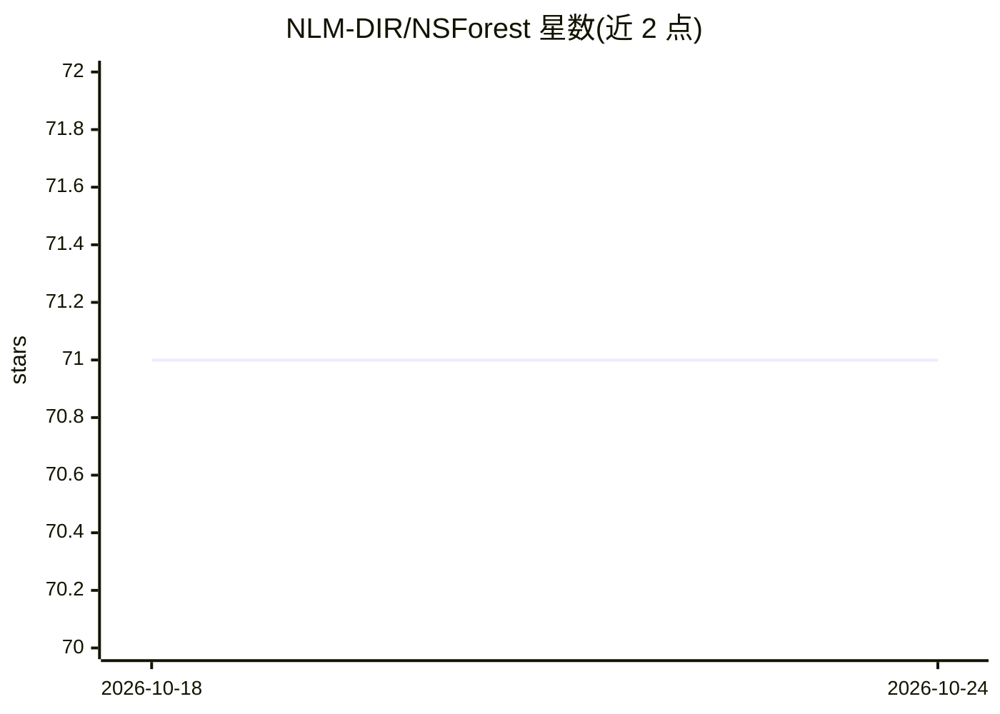

# NLM-DIR/NSForest

⭐ 71 · HTML · MIT · 推送 2026-10-08 · [GitHub](https://github.com/NLM-DIR/NSForest) · 组织维护

**从单细胞RNA测序数据发现最小标志基因组合的机器学习工具**

NS-Forest 是面向单细胞/单核 RNA 测序数据分析的机器学习算法与 Python 包：输入带细胞类型聚类标签的 AnnData 对象（.h5ad），先计算每个基因对每簇的二进制表达评分并按 2 个标准差筛选候选，再用随机森林（Gini 不纯度）排序，最后用决策树枚举组合选出 F-beta 最高的组合，每簇输出 1-6 个标志基因及 F-beta/精确率/召回率/OTF 指标。另提供标志基因集合评估模块，可对比任意标志基因列表的分类表现。由 NIH NLM 等机构团队维护，通过 git clone 源码安装，依赖 scanpy、scikit-learn 等库。

## 筛选速览

| 维度 | 判定 | 备注 |
|---|---|---|
| AI 角色 | `ai-native` | 本体是模型或模型工具 |
| 许可风险 | `permissive` | MIT |
| 部署形态 | `None` |  |
| 模型依赖 | — | README 未给出锁定关系 |
| 硬件要求 | — | 无带数字的原话,不猜 |
| 安装摩擦 | `low` | 无编译、无系统依赖或容器化 |
| 成熟度 | — | 结构信号不足 |

## 能力要点

- 二进制评分+随机森林+决策树的三步标志基因筛选流程
- 每簇输出 1-6 个最小标志基因组合及 F-beta/precision/recall/OTF 指标
- 独立的标志基因集合评估模块，可对比不同标志基因列表

## 适用场景

- 为单细胞测序的细胞类型注释挑选最小标志基因组合
- 评估和比较已有标志基因列表的分类表现
- 构建流式实验或细胞分类所需的精简 marker panel

## 场景标签

`数据分析` · 领域:效率与自动化

## 证据(README 行号)

> L28: NS-Forest is an algorithm designed to identify minimum combinations of necessary and sufficient marker genes for a 
> L33: 4. Random forest: The top 15 binary score genes are used as input into a random forest classifier, which ranks the 
> L34: 5. Decision tree evaluation: The top 6 ranked random forest genes are used as input into decision trees where all c

## 星数曲线

2026-10-18 71 → 2026-10-24 71（+0）

---
*卡片 v1 · prompt 1.4 · 生成 2026-10-24 · 置信度 high · 依据 README sha `41ea8713e65e` · [字段定义](../../DATASET.md)*
