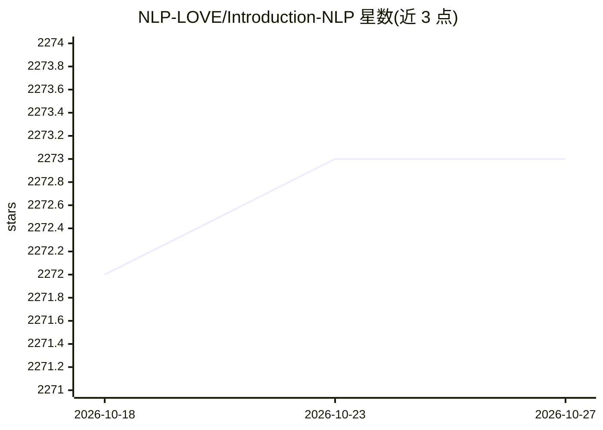

# NLP-LOVE/Introduction-NLP

⭐ 2,273 · Python · Apache-2.0 · 推送 2026-01-09 · [GitHub](https://github.com/NLP-LOVE/Introduction-NLP) · [官网](http://era.dx3906.info) · 个人维护 · 中文 README

**《自然语言处理入门》一书的学习笔记与知识梳理**

个人学习笔记仓库：作者按章节记录阅读 HanLP 作者何晗所著《自然语言处理入门》的总结，内容覆盖中文分词、词性标注、命名实体识别、信息抽取、文本聚类、文本分类、句法分析的算法原理与工程实现。面向希望系统掌握 NLP 知识的学习者，作为书本的辅助材料使用。仓库另指向同作者的机器学习/深度学习笔记项目 ML-NLP 与 HanLP 项目主页，并提供思维导图的公众号获取方式。不含可运行的软件代码。

## 筛选速览

| 维度 | 判定 | 备注 |
|---|---|---|
| AI 角色 | `ai-knowledge` | 知识聚合/清单类 |
| 许可风险 | `permissive` | Apache-2.0 |
| 部署形态 | `None` |  |
| 模型依赖 | — | README 未给出锁定关系 |
| 硬件要求 | — | 无带数字的原话,不猜 |
| 安装摩擦 | `low` | 无编译、无系统依赖或容器化 |
| 成熟度 | — | 结构信号不足 |

## 能力要点

- 覆盖中文分词、命名实体识别、文本分类等 7 类 NLP 主题的笔记
- 关联同作者 ML-NLP 机器学习/深度学习笔记项目
- 提供 NLP 知识思维导图获取途径

## 适用场景

- 学习《自然语言处理入门》时对照笔记理清知识要点
- 快速查找 NLP 各任务的算法原理总结

## 场景标签

`教程课程` · 领域:学习与行业

## 证据(README 行号)

> L2: HanLP作者何晗老师的新书《自然语言处理入门》详细笔记！业界良心之作，书中不是枯燥无味的公式罗列，而是用白话阐述的通俗易懂的算法模型。从基本概念出发，逐步介绍**中文分词、词性标注、命名实体识别、信息抽取、文本聚类、文本分类、句法
> L4: 本项目旨在帮助更多同路人能够快速的掌握 NLP 的专业知识，理清知识要点，在工作中发挥更大的作用。以书本为主，记录本人学习此书的心路历程、总结和笔记。

## 星数曲线

2026-10-18 2,272 → 2026-10-27 2,273（+1）

---
*卡片 v1 · prompt 1.4 · 生成 2026-10-21 · 置信度 high · 依据 README sha `41a3285b5ca5` · [字段定义](../../DATASET.md)*
