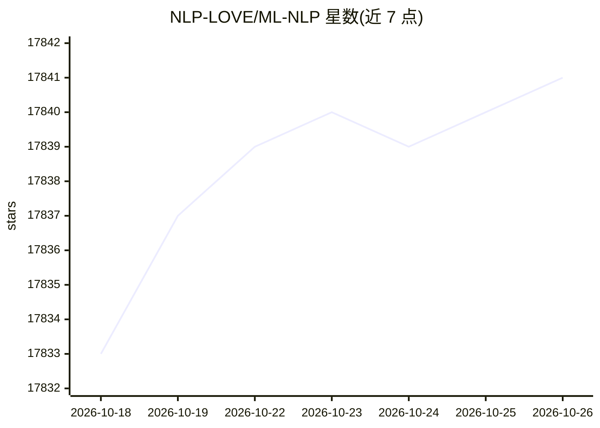

# NLP-LOVE/ML-NLP

⭐ 17,841 · Jupyter Notebook · 推送 2026-01-09 · [GitHub](https://github.com/NLP-LOVE/ML-NLP) · [官网](http://era.dx3906.info) · 个人维护 · 中文 README

**机器学习/NLP 面试知识点与代码实现的中文知识库**

面向算法工程师求职与复习的学习资料仓库：按模块整理机器学习、深度学习、NLP 面试常考知识点，每章列出可能被问到的面试问题，并附算法实战代码案例；以建立清晰知识体系为目标，定位为常读常记的复习材料。作者自述不以全面为目标，思维导图需通过微信公众号回复关键词获取。

## 筛选速览

| 维度 | 判定 | 备注 |
|---|---|---|
| AI 角色 | `ai-knowledge` | 知识聚合/清单类 |
| 许可风险 | `none` | — |
| 部署形态 | `None` |  |
| 模型依赖 | — | README 未给出锁定关系 |
| 硬件要求 | — | 无带数字的原话,不猜 |
| 安装摩擦 | `low` | 无编译、无系统依赖或容器化 |
| 成熟度 | — | 结构信号不足 |

## 动量与使用信号

- 维护:`declining` — 距上次 push 281.7 天,年发版 0,2 位贡献者
- 涨星:近 1 天 **+1**(自 20261016 起算)

## 能力要点

- 机器学习/深度学习/NLP 面试常考知识点整理
- 各章附算法实战代码案例
- 按模块组织的知识体系，附思维导图获取途径

## 适用场景

- 算法工程师岗位面试前复习知识点
- 系统性学习机器学习与 NLP 基础理论
- 面试前查阅高频考点与代码实现

## 场景标签

`教程课程` · 领域:学习与行业

## 证据(README 行号)

> L3: - 此项目是**机器学习、NLP面试**中常考到的**知识点和代码实现**，也是作为一个算法工程师必会的理论基础知识。
> L5: - 此项目以各个模块为切入点，让大家有一个清晰的知识体系。

## 星数曲线

2026-10-18 17,833 → 2026-10-26 17,841（+8）

---
*卡片 v1 · prompt 1.4 · 生成 2026-10-18 · 置信度 high · 依据 README sha `c4dadbd85186` · [字段定义](../../DATASET.md)*
