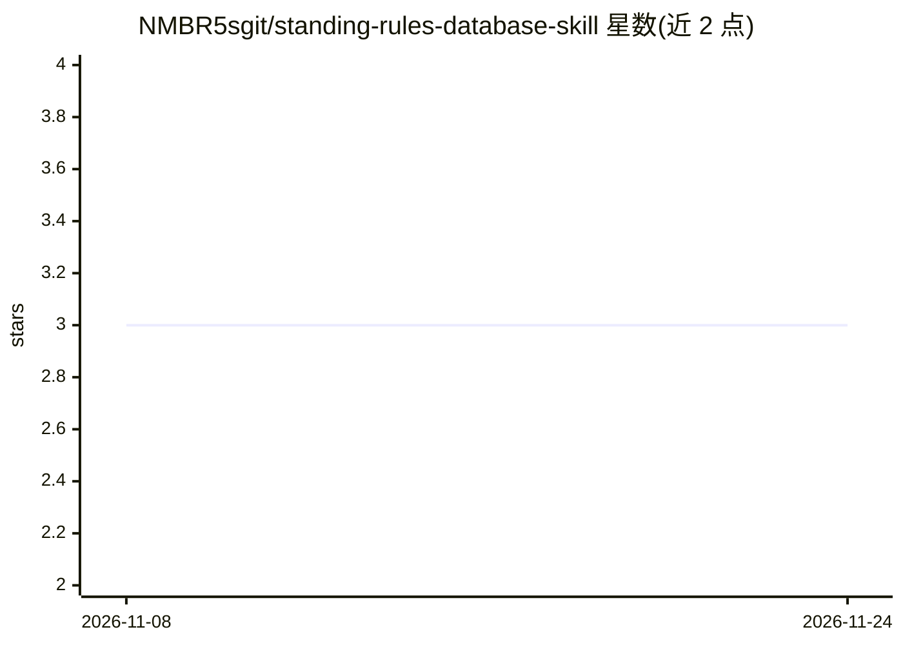

# NMBR5sgit/standing-rules-database-skill

⭐ — · [GitHub]() · 个人维护

**面向 AI agent 的本地 SQLite 规则库：按任务只加载匹配规则**

以 SQLite 为权威存储的常设规则数据库 skill：规则分两层，Tier 1 必备规则随注入式记忆确定性加载，Tier 2 规则通过 SKILL.md 中的调度索引按关键词查询、仅匹配项进入上下文。附带规则写入门禁（查重、矛盾检查、用户审批）、优先级与冲突处理、状态生命周期，以及可选的企业同步（webhook、org 规则、审批队列、审计日志）。skill 本身不含任何规则，规则从用户自身的记忆文件扫描导入。关键词匹配不涉及语义，措辞不重叠的规则可能漏检。

## 筛选速览

| 维度 | 判定 | 备注 |
|---|---|---|
| AI 角色 | `ai-ecosystem` | LLM/agent 周边工具 |
| 许可风险 | `permissive` | — |
| 部署形态 | `library` | 以包/库形式分发 |
| 模型依赖 | — | README 未给出锁定关系 |
| 硬件要求 | — | 无带数字的原话,不猜 |
| 安装摩擦 | `low` | 无编译、无系统依赖或容器化 |
| 成熟度 | — | 结构信号不足 |

## 能力要点

- 规则数与上下文成本解耦：500 条规则与 30 条的单任务上下文成本相同
- 实测查询延迟约 0.39ms，聚焦查询带来约 85% 上下文节省
- 写入门禁：查重、矛盾标记、用户审批后才能激活规则
- 可选企业同步：org 规则、审批队列、kill switch、审计账本

## 适用场景

- 把散落在 CLAUDE.md/记忆文件里的常设规则收敛成可查询的数据库
- 规则数量增长后控制每次注入 prompt 的上下文开销
- 团队场景下由 IT 统一下发和吊销组织级规则

## 场景标签

`Agent 记忆` · 领域:Agent 开发

## 证据(README 行号)

> L5: `standing-rules-database-skill` is the middle design: **a persistent rule database that grows, consulted per-task, w
> L19: 2. **Tier 2 (conditional, fetched).** Everything else lives in the database behind a **dispatch index** in SKILL.md
> L108: Copy `SKILL.md` into your agent's skills directory (Hermes, Claude Code skills, or any agent that loads instructio

## 星数曲线

2026-11-08 3 → 2026-11-24 3（+0）

---
*卡片 v1 · prompt 1.4 · 生成 2026-11-22 · 置信度 high · 依据 README sha `489b9f34ce02` · [字段定义](../../DATASET.md)*
