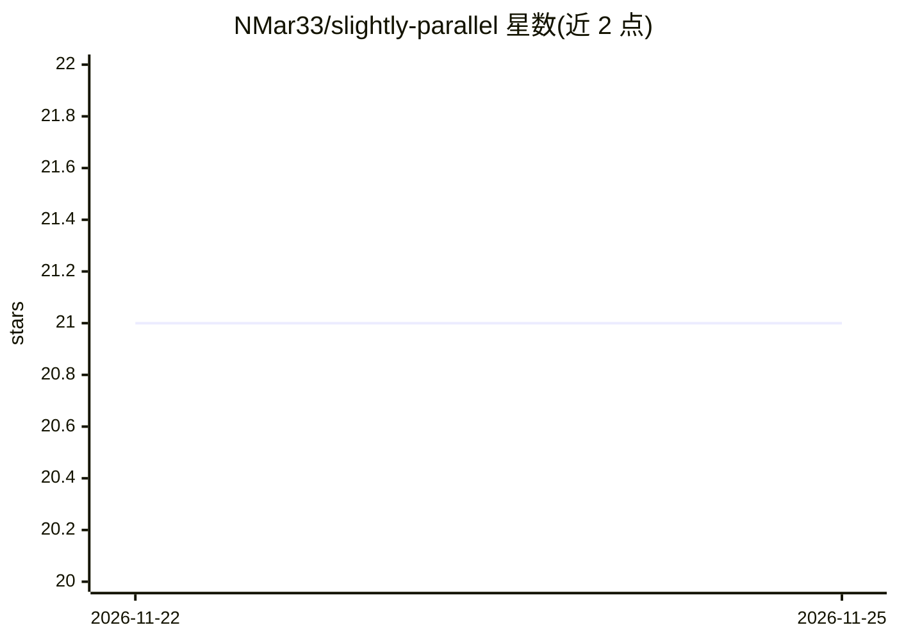

# NMar33/slightly-parallel

⭐ 21 · TypeScript · MIT · 推送 2026-11-23 · [GitHub](https://github.com/NMar33/slightly-parallel) · 个人维护

**自托管的编码 agent 多项目管理仪表盘**

运行在本机的开源仪表盘，用于管理跨多个项目的编码 agent（Claude Code、Codex、OpenCode）。通过 hooks 记录聊天与 Git 活动，提供任务看板、聊天搜索、架构管理（#core/#entrypoint/#scan）、经验条目（提示词/规则/技能/问题/决策）的保存与复用，并可通过标签命令在既有终端内操作；可选基于 Electron 的 SP 终端。数据以纯文件（CSV/Markdown）存储于自选数据文件夹，服务器仅监听 127.0.0.1 且无登录。

## 筛选速览

| 维度 | 判定 | 备注 |
|---|---|---|
| AI 角色 | `ai-ecosystem` | LLM/agent 周边工具 |
| 许可风险 | `permissive` | MIT |
| 部署形态 | `None` |  |
| 模型依赖 | — | README 未给出锁定关系 |
| 硬件要求 | — | 无带数字的原话,不猜 |
| 安装摩擦 | `low` | 无编译、无系统依赖或容器化 |
| 成熟度 | — | 结构信号不足 |

## 能力要点

- 通过 hooks 记录 agent 聊天并存储为 chat.md 与 CSV/Markdown 文件
- #task/#now/#rule/#prompt 等标签命令在看板与终端内管理任务与经验条目
- 架构追踪（#core/#entrypoint/#scan）与架构评审机制
- 本地 Web 仪表盘（25 个页面，英语/俄语）加可选 Electron SP 终端

## 适用场景

- 在多个项目中同时使用编码 agent 并保留全部聊天记录以便检索
- 在终端中用标签命令随手建任务、存规则与决策而不打断当前工作
- 定期做架构检查点并回到此前未完成的任务话题

## 场景标签

`编码 Agent` · 领域:编码与开发

## 证据(README 行号)

> L9: Slightly Parallel is an open-source dashboard that runs on your own computer and helps you to manage projects with m
> L13: - Claude Code, Codex, OpenCode
> L166: - Agents write only through the MCP server. For example, they use `write_entry` to record a decision. The contract

## 星数曲线

2026-11-22 21 → 2026-11-25 21（+0）

---
*卡片 v1 · prompt 1.4 · 生成 2026-11-22 · 置信度 high · 依据 README sha `a03148a0c68b` · [字段定义](../../DATASET.md)*
