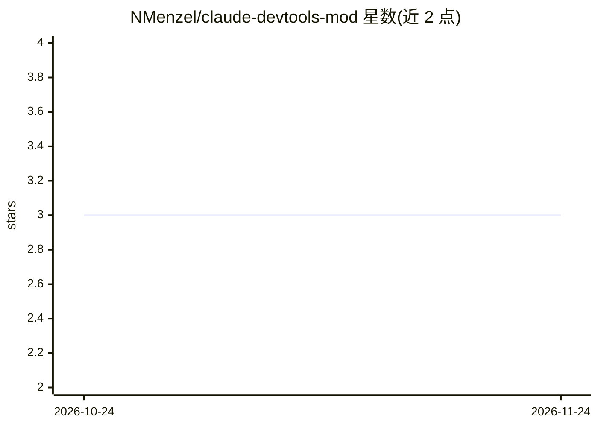

# NMenzel/claude-devtools-mod

⭐ — · [GitHub]() · 个人维护

**为 Claude Code 用户提供工具调用断点调试与失败诊断**

基于 Claude Code 原生 Mods API 构建的调试器扩展：对工具、命令模式、路径通配与失败设置断点，支持 Continue/Step/Reject 交互，提供实时面板、时间线、调用检查器与 Error Lens 失败分类诊断，导出可脱敏的 JSON/Markdown 记录。仅工作在工具调用层面，不展示模型内部推理；自身不做网络或模型调用，审批仍由 Claude Code 权限规则决定。需 Claude Code 2.1.287+，通过插件市场两条命令安装。

## 筛选速览

| 维度 | 判定 | 备注 |
|---|---|---|
| AI 角色 | `ai-ecosystem` | LLM/agent 周边工具 |
| 许可风险 | `permissive` | — |
| 部署形态 | `library` | 以包/库形式分发 |
| 模型依赖 | — | README 未给出锁定关系 |
| 硬件要求 | — | 无带数字的原话,不猜 |
| 安装摩擦 | `low` | 无编译、无系统依赖或容器化 |
| 成熟度 | `idea` | |

## 能力要点

- 对工具、命令、路径与错误设置断点，支持 Continue/Step/Reject 及附注拒绝
- Error Lens 失败诊断：分类错误类型、标注已确认/可能/未知证据并给出修复建议
- 时间线与检查器记录每次调用的状态、时长、权限判定与断点命中
- 无网络调用、无模型调用、无需 npm 包或克隆仓库

## 适用场景

- 在 agent 执行 git push、npm publish 等高风险命令前暂停审查
- 按路径通配拦截对敏感代码目录的读写操作
- 诊断反复出现的工具调用失败原因
- 导出脱敏后的调用记录做事后复盘

## 场景标签

`LLM 可观测性` · 领域:评测与运维

## 证据(README 行号)

> L7:  A Claude Code mod that works like a debugger for tool calls: breakpoints on tools, commands, files and errors · Con
> L31: **Claude DevTools is a debugger for the agent's tool level**, built on Claude Code's native Mods API.
> L44: It works at the tool level only. It does **not** show hidden reasoning, model

## 星数曲线

2026-10-24 3 → 2026-11-24 3（+0）

---
*卡片 v1 · prompt 1.4 · 生成 2026-11-22 · 置信度 mid · 依据 README sha `53c553c9c64c` · [字段定义](../../DATASET.md)*
