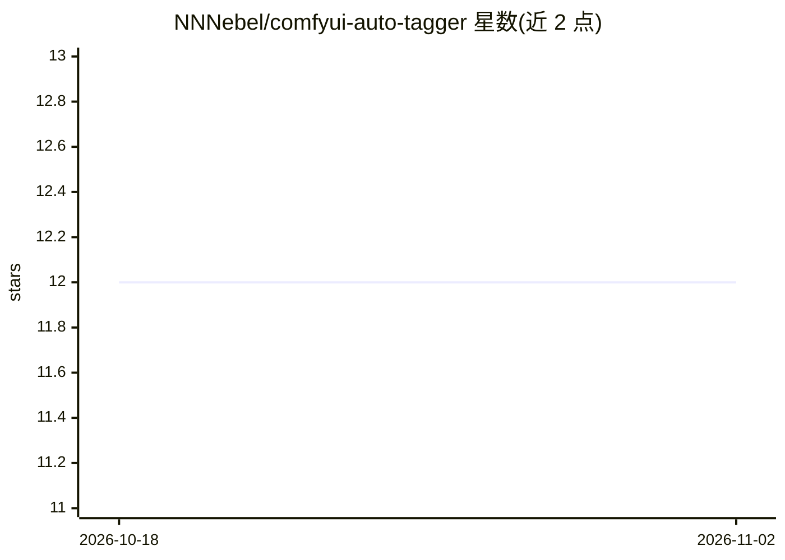

# NNNebel/comfyui-auto-tagger

⭐ 12 · JavaScript · MIT · 推送 2026-05-05 · [GitHub](https://github.com/NNNebel/comfyui-auto-tagger) · 个人维护 · 中文 README

**Eagle 图片管理插件：自动提取 AI 生图元数据为标签和备注**

面向图片收集管理软件 Eagle 的插件，自动解析 ComfyUI、Stable Diffusion WebUI（Automatic1111/Forge 等派生）及 Civitai 生成的 PNG/WebP/JPEG/MP4 文件中的元数据，将 Checkpoint、LoRA、提示词、Seed、Sampler 等信息写入 Eagle 的标签与备注，并支持选择导入项与批量处理。核心机制是追溯 ComfyUI 工作流图提取实际执行路径参数，对未使用节点给出可疑节点检测交由用户判定；不保证 100% 兼容复杂工作流。安装通过 Releases 的 .eagleplugin 文件拖入 Eagle，无外部依赖。

## 筛选速览

| 维度 | 判定 | 备注 |
|---|---|---|
| AI 角色 | `ai-enhanced` | 去掉 AI 部分产品仍成立 |
| 许可风险 | `permissive` | MIT |
| 部署形态 | `None` |  |
| 模型依赖 | — | README 未给出锁定关系 |
| 硬件要求 | — | 无带数字的原话,不猜 |
| 安装摩擦 | `low` | 无编译、无系统依赖或容器化 |
| 成熟度 | — | 结构信号不足 |

## 能力要点

- 解析 ComfyUI/A1111/Civitai 元数据并写入 Eagle 标签与备注
- 动态追溯 ComfyUI 工作流实际执行路径，支持多阶段（HiresFix/FaceDetailer）工作流
- 可疑节点检测：交由用户决定纳入或排除
- 选中图片即显示生成信息面板，各字段带复制按钮；支持批量处理

## 适用场景

- 在 Eagle 中整理和检索 AI 生成图片，按模型/提示词/参数过滤
- 查看并复制选中图片的提示词与生成参数
- 批量回填历史 AI 图片的元数据标签

## 场景标签

 · 领域:图像管理/生成式AI工具链

## 证据(README 行号)

> L9: **ComfyUI Auto Tagger** is a plugin for Eagle that automatically extracts metadata from AI-generated images. It prov
> L14: It supports **ComfyUI**, **Stable Diffusion WebUI** (including Automatic1111, Forge, and other variants; referred t

## 星数曲线

2026-10-18 12 → 2026-11-02 12（+0）

---
*卡片 v1 · prompt 1.4 · 生成 2026-11-01 · 置信度 mid · 依据 README sha `ac07d6879bd6` · [字段定义](../../DATASET.md)*
