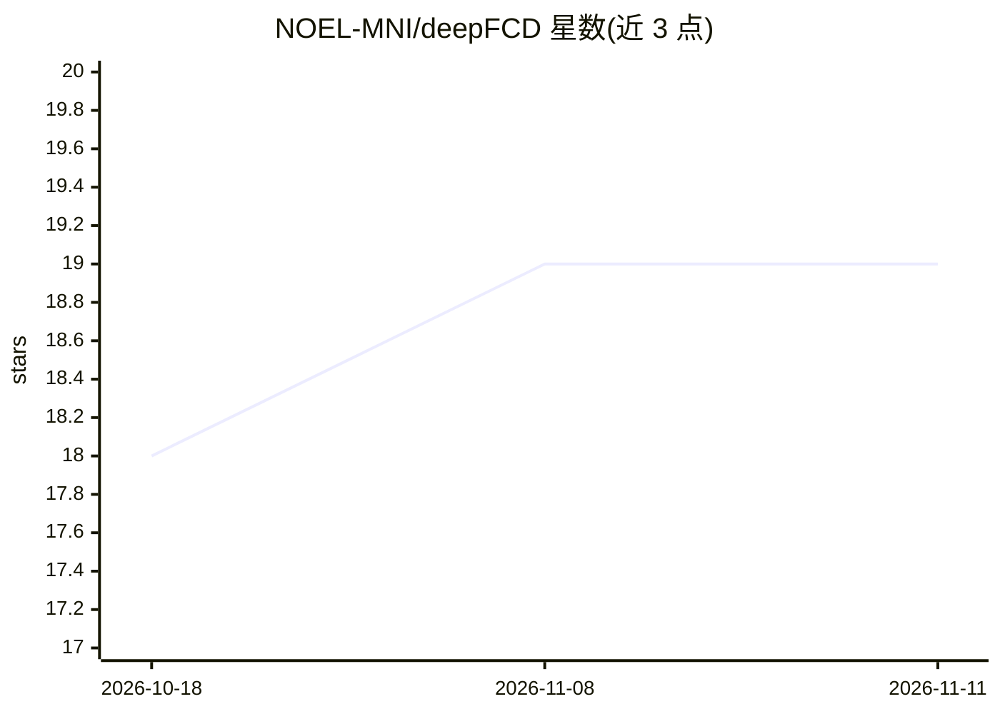

# NOEL-MNI/deepFCD

⭐ — · [GitHub]() · 组织维护

**深度学习 MRI 检测局灶性皮质发育不良（FCD）的工具**

Neurology 2021 多中心验证论文的官方代码库：对多模态 MRI（T1、FLAIR）运行深度学习推理，自动检测局灶性皮质发育不良（FCD，一种与癫痫相关的脑皮层畸形），并生成检测报告。提供 Python 脚本与 Docker 镜像，支持 CPU 与 GPU（含 nvidia-container-toolkit）推理；依赖 Conda 环境、Python 3.8.20 与 Keras 2.2.4，通过 git clone 带 deepMask 子模块安装。训练流程标注为 TODO 未给出。

## 筛选速览

| 维度 | 判定 | 备注 |
|---|---|---|
| AI 角色 | `ai-native` | 本体是模型或模型工具 |
| 许可风险 | `permissive` | — |
| 部署形态 | `self-host` | docker 或自建部署 |
| 模型依赖 | — | README 未给出锁定关系 |
| 硬件要求 | — | 无带数字的原话,不猜 |
| 安装摩擦 | `low` | 无编译、无系统依赖或容器化 |
| 成熟度 | — | 结构信号不足 |

## 能力要点

- 对 T1/FLAIR 多模态 MRI 执行深度学习 FCD 检测推理
- 提供 CPU 与 GPU 两种推理路径及 Docker 镜像
- 附带独立报告生成脚本 reporting.py
- 多中心验证论文（Neurology 2021）官方实现，数据 DOI 附注

## 适用场景

- 对癫痫患者 MRI 数据运行 FCD 自动检测
- 科研中复现多中心验证的检测算法结果
- 批量处理患者影像并生成检测报告

## 场景标签

`科研工具` · 领域:学习与行业

## 证据(README 行号)

> L2:  Multicenter Validated Detection of Focal Cortical Dysplasia using Deep Learning
> L63: ./app/inference.py     \ # the script to perform inference on the multimodal MRI images

## 星数曲线

2026-10-18 18 → 2026-11-11 19（+1）

---
*卡片 v1 · prompt 1.4 · 生成 2026-10-29 · 置信度 high · 依据 README sha `a9992d304856` · [字段定义](../../DATASET.md)*
