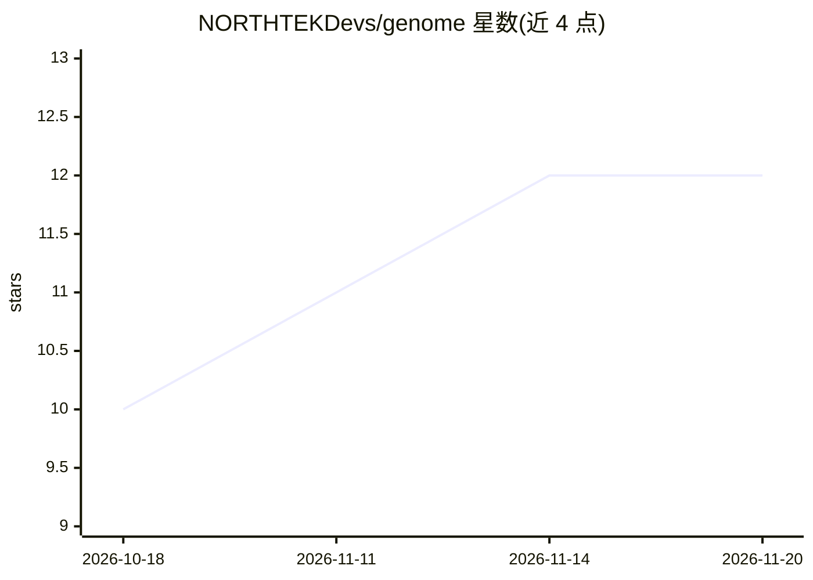

# NORTHTEKDevs/genome

⭐ 12 · Python · Apache-2.0 · 推送 2026-11-02 · [GitHub](https://github.com/NORTHTEKDevs/genome) · [官网](https://northtek.io) · 组织维护

**AI agent 的可审计本地记忆层，写入零 LLM 调用**

为 AI agent 提供持久化记忆的 Python 库：写入路径仅在本地嵌入消息（约 10ms/条，零 LLM 调用、零网络），读取时做精确余量检索加可选本地重排；支持双时间线事实记录、来源信任隔离、可重放篡改可检测的 journal，以及多 agent 信念归属。附带全本地 MCP server，为 Claude Desktop、Claude Code、Cursor 等提供跨会话记忆；提供 LoCoMo/LongMemEval 基准复现脚本与中性评测 harness。Apache-2.0，Python 3.11-3.14。

## 筛选速览

| 维度 | 判定 | 备注 |
|---|---|---|
| AI 角色 | `ai-ecosystem` | LLM/agent 周边工具 |
| 许可风险 | `permissive` | Apache-2.0 |
| 部署形态 | `self-host` | docker 或自建部署 |
| 模型依赖 | — | README 未给出锁定关系 |
| 硬件要求 | — | 无带数字的原话,不猜 |
| 安装摩擦 | `low` | 无编译、无系统依赖或容器化 |
| 成熟度 | — | 结构信号不足 |

## 能力要点

- 写入路径本地嵌入，零 LLM/网络调用，可离线运行
- 双时间线事实层支持按时间点提问
- journal 重放与 HMAC 链实现可审计、可回滚的记忆
- 全本地 MCP server 提供 remember/recall/forget 等工具

## 适用场景

- 给本地运行的 agent 加跨会话持久记忆且数据不出机
- 受监管环境内网部署的 agent 记忆方案
- 按来源隔离低信任内容防止提示注入写入
- 复现 LoCoMo/LongMemEval 上与 Mem0 的对比评测

## 场景标签

`Agent 记忆` `模型评测` · 领域:Agent 开发

## 证据(README 行号)

> L119: ## Add persistent memory to your agent in one line (MCP)
> L121: GENOME ships a **fully-local MCP server** - cross-session memory for Claude Desktop, Claude
> L241: pip install genome-memory

## 星数曲线

2026-10-18 10 → 2026-11-20 12（+2）

---
*卡片 v1 · prompt 1.4 · 生成 2026-11-18 · 置信度 mid · 依据 README sha `61c14e22af0d` · [字段定义](../../DATASET.md)*
