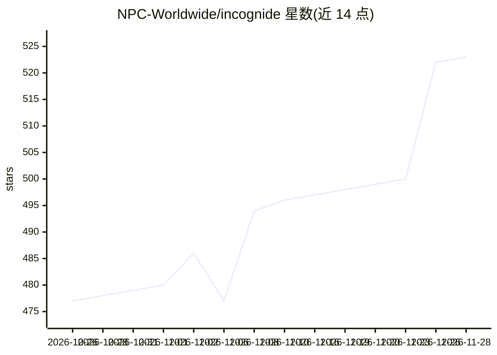

# NPC-Worldwide/incognide

⭐ 523 · TypeScript · MIT · 推送 2026-11-24 · [GitHub](https://github.com/NPC-Worldwide/incognide) · [官网](https://incognide.com) · 组织维护

**面向个人与团队的 AI 工作台：聊天/代码/文档/浏览器一体化**

一款桌面工作台应用（Electron，Linux/macOS/Windows 安装包），将聊天、代码编辑、终端、文档（DOCX/XLSX/PPTX）、PDF 标注、3D 模型查看、数据仪表盘与 LaTeX 编译整合为可平铺的多标签工作区，支持路径式组织与自动保存的工作区恢复。AI 部分为可选路径：可选择纯工作区（无模型调用）、云端 API 或本地模型（Ollama/LM Studio/llama.cpp/oMLX），并提供 Agent 管理、定时任务、MCP 集成、记忆抽取、知识图谱演化与文本模型微调功能。

## 筛选速览

| 维度 | 判定 | 备注 |
|---|---|---|
| AI 角色 | `ai-enhanced` | 去掉 AI 部分产品仍成立 |
| 许可风险 | `permissive` | MIT |
| 部署形态 | `library` | 以包/库形式分发 |
| 模型依赖 | local-ok | 支持本地模型 |
| 硬件要求 | — | 无带数字的原话,不猜 |
| 安装摩擦 | `low` | 无编译、无系统依赖或容器化 |
| 成熟度 | — | 结构信号不足 |

## 能力要点

- 平铺式多标签工作区：聊天、编辑器、PDF、浏览器、终端、3D 查看器各自独立状态
- 三种使用路径：无 AI 纯工作区、云 API（OpenAI/Anthropic/Gemini 等）、本地模型探测与启停
- Agent 定时任务、MCP Server 集成、记忆抽取与知识图谱演化
- 基于对话与记忆数据的文本模型微调

## 适用场景

- 在单一窗口内完成写代码、看文档、查网页的日常工作
- 接入本地模型在离线环境下使用 AI 助手
- 管理多个 Agent 定时执行任务并维护知识图谱
- 直接编辑 Office 文档和标注 PDF 无需切换应用

## 场景标签

`AI 助手` `知识图谱` `微调` · 领域:对话与助手

## 证据(README 行号)

> L13: Incognide unifies chat, code, documents, web browsing, and media into a tileable workspace with intelligent context
> L42:  - **No AI** — workspace only (files, code, browsers, terminals, docs, maps). No model calls.
> L44:  - **Local AI** — Ollama / LM Studio / llama.cpp / oMLX running on your machine.

## 星数曲线

2026-10-26 477 → 2026-11-28 523（+46）

---
*卡片 v1 · prompt 1.4 · 生成 2026-11-26 · 置信度 mid · 依据 README sha `4e1ea38bdf81` · [字段定义](../../DATASET.md)*
