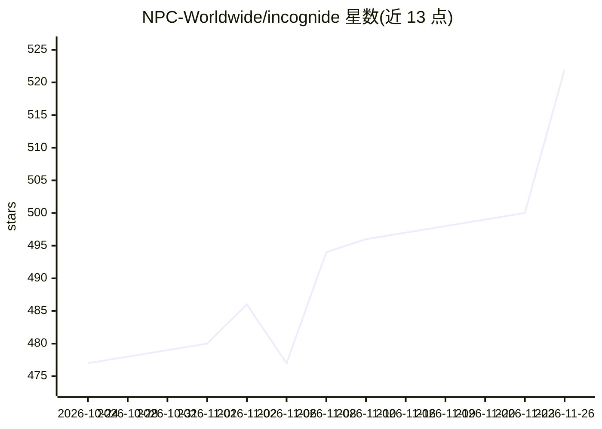

# NPC-Worldwide/incognide

⭐ 522 · TypeScript · MIT · 推送 2026-11-24 · [GitHub](https://github.com/NPC-Worldwide/incognide) · [官网](https://incognide.com) · 组织维护

**可平铺工作区应用：整合聊天、代码、文档与 AI 模型接入**

Electron 形式的桌面工作区，把聊天、代码编辑、终端、浏览器、PDF、3D 查看器组织为可平铺的磁贴布局，带路径化组织与自动保存工作区。AI 部分可选用：无 AI 纯工作区模式，或通过模型管理器接入本地运行时与多家云 API（OpenAI 兼容格式），另支持 agent 定时任务、记忆抽取、知识图谱演化，以及调用外部 Python venv 进行模型微调。提供 Linux/macOS/Windows 安装包。

## 筛选速览

| 维度 | 判定 | 备注 |
|---|---|---|
| AI 角色 | `ai-enhanced` | 去掉 AI 部分产品仍成立 |
| 许可风险 | `permissive` | MIT |
| 部署形态 | `library` | 以包/库形式分发 |
| 模型依赖 | local-ok | 支持本地模型 |
| 硬件要求 | — | 无带数字的原话,不猜 |
| 安装摩擦 | `medium` | 含编译或系统依赖之一 |
| 成熟度 | — | 结构信号不足 |

## 能力要点

- 磁贴式工作区：聊天、编辑器、PDF、浏览器、终端、3D 查看器各标签独立状态
- 可选 AI 路径：无 AI / 云端 API key / 本地运行时三种模式
- Model Manager 探测本地服务状态并提供启动/停止操作
- 通过外部 Python venv 安装 torch/transformers 等包进行模型微调

## 适用场景

- 把代码、文档、浏览器和 AI 聊天整合到一个桌面工作区
- 用本地模型（Ollama/llama.cpp 等）离线使用 AI 功能
- 管理 agent 定时任务与知识图谱的记忆演化
- 基于自己的对话数据微调文本模型

## 场景标签

`AI 助手` `知识图谱` `微调` · 领域:对话与助手

## 证据(README 行号)

> L13: Incognide unifies chat, code, documents, web browsing, and media into a tileable workspace with intelligent context
> L42:  - **No AI** — workspace only (files, code, browsers, terminals, docs, maps). No model calls.
> L44:  - **Local AI** — Ollama / LM Studio / llama.cpp / oMLX running on your machine.

## 星数曲线

2026-10-24 477 → 2026-11-26 522（+45）

---
*卡片 v1 · prompt 1.4 · 生成 2026-11-25 · 置信度 high · 依据 README sha `4e8e319bb7a1` · [字段定义](../../DATASET.md)*
