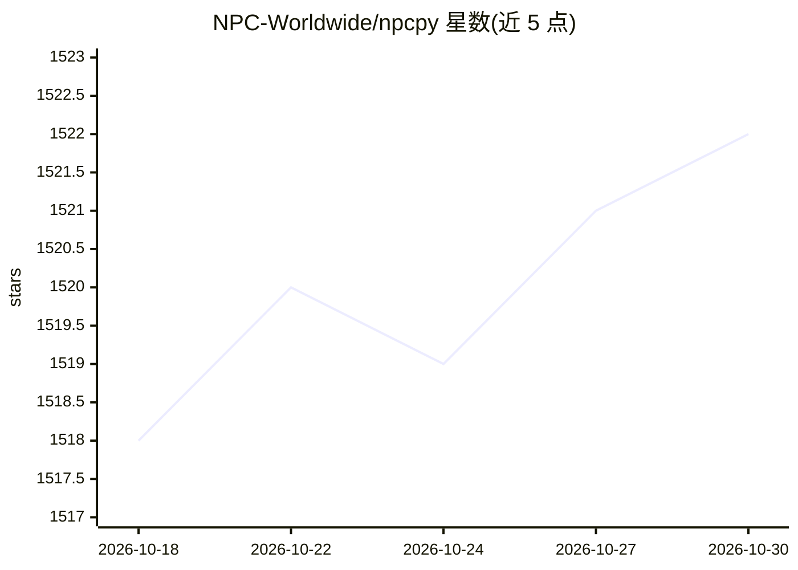

# NPC-Worldwide/npcpy

⭐ 1,522 · Python · MIT · 推送 2026-10-29 · [GitHub](https://github.com/NPC-Worldwide/npcpy) · 组织维护

**多智能体与知识图谱研发的 Python 库，支持本地/云端模型**

面向研究者和开发者的 Python 库，为多模态 LLM、agentic AI 与知识图谱提供构建原语：NPC/Agent/ToolAgent/CodingAgent 等智能体类、多智能体 Team 编排、Jinx（Jinja 执行模板）工作流、MCP 服务器/客户端接入、图像/音频/视频生成、知识图谱的睡/梦生命周期演化（含 Sememolution 种群演化）、SFT/DPO 微调与 Flask 部署。支持本地运行时（ollama、llama.cpp、LM Studio 等）与云端服务商，通过 pip 安装，并提供交互式 Shell（npcsh）与可执行 .npc/.jinx 文件。README 中含推广性质的产品链接。

## 筛选速览

| 维度 | 判定 | 备注 |
|---|---|---|
| AI 角色 | `ai-ecosystem` | LLM/agent 周边工具 |
| 许可风险 | `permissive` | MIT |
| 部署形态 | `library` | 以包/库形式分发 |
| 模型依赖 | local-ok | 支持本地模型 |
| 硬件要求 | — | 无带数字的原话,不猜 |
| 安装摩擦 | `medium` | 含编译或系统依赖之一 |
| 成熟度 | — | 结构信号不足 |

## 能力要点

- Agent 体系：Agent/ToolAgent/CodingAgent，默认工具与 MCP 服务器接入
- 多智能体 Team 编排与 NPCArray 并行执行
- 知识图谱睡/梦生命周期与 Sememolution 种群演化
- SFT/DPO/扩散模型微调与 Flask REST 部署

## 适用场景

- 构建带工具调用的多智能体团队完成分析、写作等任务
- 从文本构建并持续演化知识图谱
- 对工具调用 agent 做 DPO 强化学习训练或 SFT
- 通过 MCP 服务器为 agent 接入外部数据库与 API

## 场景标签

`多智能体` `知识图谱` `微调` · 领域:Agent 开发

## 证据(README 行号)

> L10: `npcpy` is a library that provides key primitives for research and development with multimodal language models, age
> L411: - **Agents (NPCs)** — Agents with personas, directives, and tool calling. Subclasses: `Agent` (default tools), `To
> L412: - **Multi-Agent Teams** — Team orchestration with a coordinator (forenpc)

## 星数曲线

2026-10-18 1,518 → 2026-10-30 1,522（+4）

---
*卡片 v1 · prompt 1.4 · 生成 2026-10-21 · 置信度 high · 依据 README sha `d9393c2bdd79` · [字段定义](../../DATASET.md)*
