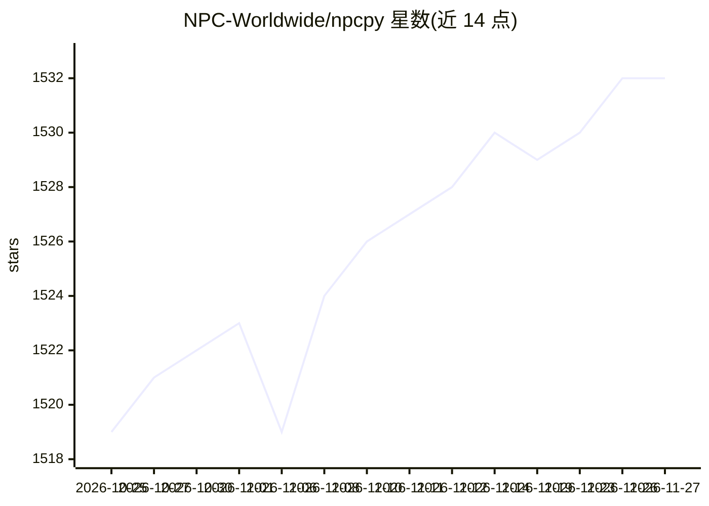

# NPC-Worldwide/npcpy

⭐ 1,532 · Python · MIT · 推送 2026-11-26 · [GitHub](https://github.com/NPC-Worldwide/npcpy) · 组织维护

**面向开发者的多模态 LLM、Agent 与知识图谱 Python 构建库**

npcpy 提供用于多模态语言模型、agentic AI 与知识图谱研发的原语：NPC/Agent/ToolAgent/CodingAgent 类、多智能体团队编排（NPCArray、Team）、基于 YAML 的 .npc/.jinx 团队定义文件、MCP server 集成、流式与 JSON/Pydantic 结构化输出、图像音视频生成接口，以及带睡眠/做梦生命周期机制的知识图谱构建与检索。通过统一接口对接本地（llama.cpp、LM Studio、ollama、omlx）与云端提供商；另提供决策模型接口（choice/noul/score/predict）。以 pip 包分发，提供 Flask 服务能力。

## 筛选速览

| 维度 | 判定 | 备注 |
|---|---|---|
| AI 角色 | `ai-ecosystem` | LLM/agent 周边工具 |
| 许可风险 | `permissive` | MIT |
| 部署形态 | `library` | 以包/库形式分发 |
| 模型依赖 | local-ok | 支持本地模型 |
| 硬件要求 | — | 无带数字的原话,不猜 |
| 安装摩擦 | `medium` | 含编译或系统依赖之一 |
| 成熟度 | — | 结构信号不足 |

## 能力要点

- 统一接口调用本地与云端 LLM 提供商，支持流式与 Pydantic 结构化输出
- NPC/Agent/ToolAgent/CodingAgent 与多智能体辩论、并行执行（NPCArray）
- .npc/.jinx/team.ctx 文件格式定义团队，可直接执行，支持 MCP server 外部工具
- 知识图谱带 waking/sleeping/dreaming 生命周期与混合检索

## 适用场景

- 构建多智能体团队并编排协作任务
- 用本地 ollama 模型跑分类、评分等决策任务
- 从文本构建并演化知识图谱、抽取结构化事实
- 为 Agent 团队接入 MCP 外部工具服务

## 场景标签

`多智能体` `知识图谱` `多模态` · 领域:Agent 开发

## 证据(README 行号)

> L10: `npcpy` is a library that provides key primitives for research and development with multimodal language models, age
> L116: The `Agent` class in `npcpy` comes with a set of default tools (sh, python, edit_file, web_search, etc.)
> L306:  MCP server integration

## 星数曲线

2026-10-25 1,519 → 2026-11-27 1,532（+13）

---
*卡片 v1 · prompt 1.4 · 生成 2026-11-27 · 置信度 mid · 依据 README sha `75019272c5b2` · [字段定义](../../DATASET.md)*
