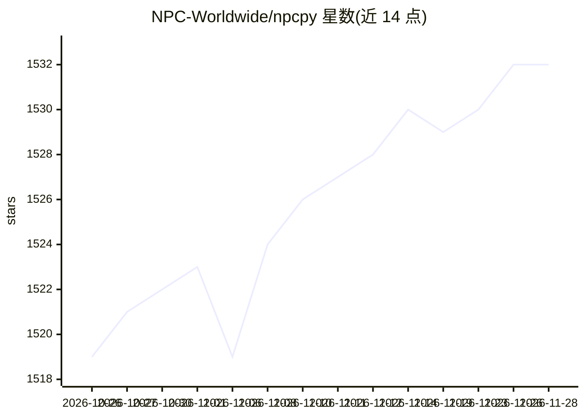

# NPC-Worldwide/npcpy

⭐ 1,532 · Python · MIT · 推送 2026-11-27 · [GitHub](https://github.com/NPC-Worldwide/npcpy) · 组织维护

**面向研究开发者的多模态 LLM/Agent/知识图谱 Python 构建库**

提供面向多模态语言模型、Agent 与知识图谱研发的基础原语：NPC 人设对象、Agent/ToolAgent/CodingAgent、多智能体团队编排（NPCArray、Team）、基于 .npc/.jinx/team.ctx 文件的可执行团队定义、MCP server 集成，以及带唤醒/睡眠/梦境生命周期的知识图谱构建与检索。支持本地运行时（llama.cpp、LM Studio、ollama、omlx）与云端提供商，并暴露 choice/noul/score/predict 决策模型接口。以 Python 库形式通过 PyPI 安装，另含 Flask 服务化与流式/JSON/Pydantic 结构化输出支持。

## 筛选速览

| 维度 | 判定 | 备注 |
|---|---|---|
| AI 角色 | `ai-ecosystem` | LLM/agent 周边工具 |
| 许可风险 | `permissive` | MIT |
| 部署形态 | `library` | 以包/库形式分发 |
| 模型依赖 | local-ok | 支持本地模型 |
| 硬件要求 | — | 无带数字的原话,不猜 |
| 安装摩擦 | `medium` | 含编译或系统依赖之一 |
| 成熟度 | — | 结构信号不足 |

## 能力要点

- 多智能体编排：Team、NPCArray 并行执行、多 Agent 辩论与迭代精炼
- .npc/.jinx/team.ctx 文件定义可直接执行的团队与技能（Skills）
- 知识图谱带 wake/sleep/dream 生命周期与混合检索
- 本地（ollama/llama.cpp/LM Studio/omlx）与云提供商统一调用接口

## 适用场景

- 构建多 Agent 团队处理分析、检索与报告生成任务
- 用 MCP server 为 NPC 团队接入外部工具
- 从文本构建可演化的知识图谱并做结构化记忆抽取
- 快速对接本地 Ollama 模型做 LLM 调用与代码生成实验

## 场景标签

`多智能体` `Agent 框架` `知识图谱` · 领域:Agent 开发

## 证据(README 行号)

> L10: `npcpy` is a library that provides key primitives for research and development with multimodal language models, age
> L115: ### Agent with tools
> L421: Build, evolve, and search knowledge graphs from text. The KG grows through waking (assimilation), sleeping (consol

## 星数曲线

2026-10-26 1,519 → 2026-11-28 1,532（+13）

---
*卡片 v1 · prompt 1.4 · 生成 2026-11-28 · 置信度 high · 依据 README sha `ba691a3a1f6a` · [字段定义](../../DATASET.md)*
